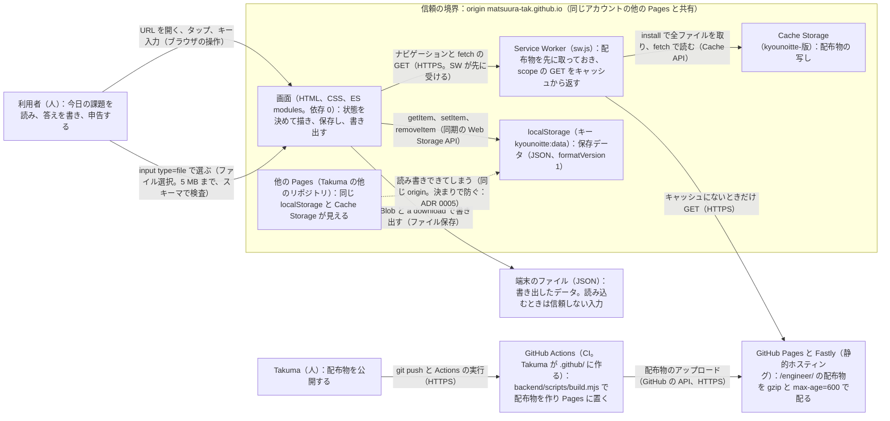

# 技術設計メモ 001-daily-learning：診断と今日の学習（今日の一手）

- 書いた役：tech-lead　日付：2026-10-30（2026-11-05 に PRD r10 と design r8 に合わせて書き直した。Takuma の FB 1 回目の作り直し）
- PRD：docs/prd/001-daily-learning.md（r10、AC-1〜AC-40）　デザイン：design/001-daily-learning.md（r8、文言 174 キー）　契約：contracts/（HTTP の API はないので OpenAPI はない。一覧は contracts/README.md）
- 読み替え：型の「operationId」は「契約のファイルと項目」、「iOS」は「ブラウザ（Safari 17 以上、Chrome の最新 2 版）」に読み替える。spectral と oasdiff は使えないので、JSON Schema の検査と見本のテストで代える（指揮役の裁定 E2）。
- Takuma の決定 D1〜D10（2026-10-30。docs/approvals/001-daily-learning-G0.md の末尾）と、FB 1 回目（docs/approvals/001-daily-learning-FB1.md）、指揮役の決定（docs/approvals/delegation.md の 2026-11-05：Q12〜Q19、S7 の再読み込み、予算の割り直し）を反映した。一覧は 10。

## 1. 範囲、目標、非目標
- 範囲：ブラウザだけで動く静的な Web アプリ（HTML、CSS、ES modules、Service Worker）と同梱の課題集（v1 は 210 件、2026-12-14 の版で 252 件）。保存は localStorage のキー 1 つ。配布は GitHub Pages の `/engineer/`。受け入れテストは Playwright（Chromium と WebKit）。
- 目標：PRD の 40 件の AC を、つなぎ口を本番に入れずに自動で確かめられる形で満たす。開いてから 2 秒、「次の一手に進む」から 1 秒、初回の転送量 150,000 バイト以下、外への送信 0 件。
- 非目標：サーバー、アカウント、同期、Web Push、裏での更新、更新の知らせ、ブラウザの中でのコードの実行、計測の送信（PRD 10）。イベントの記録（8。Takuma の決定 D6）。連続記録（ストリーク）と、それに当たる語（AC-35。Q16 の A）。演出のためのライブラリと JS のアニメーション。

### 1.1 r8 で足すことと、作り方の方針（PRD r10、design r8）
構成（ファイルの置き場所、依存 0、CSP、保存のキー、SW）は変えない。新しい依存、権限、外への送信、CSP の変更はどれも要らない（G1 tech-lead r2）。
- 同じ日に続ける（AC-33、FB-2）：S5 と S6 の `task.next` で、同じ日に次の課題を出す。保存は `current`（印がなければ `device.persistRequested` も）の setItem 1 回（data.md の 2）。操作で出すときは今日の行を見ずに選び方（data.md の 4「操作で出すとき」、5）へ進む。同じ日付の行は複数になってよい（data.md の 8。「1 つまで」をやめた）。何件目かは `data-task-nth-today`（data.md の 9）。1 秒の計り方は test-hooks.md の「時間の計り方」。段階の変化と診断のやり直しは「次に出す課題から」効く（AC-8、AC-14）。
- 修了と進級（AC-10）：今の組に出していない課題が 0 件なら S7。変種は h1 で見分ける（`task.exhausted.levelDone` / 上級は `.allDone`。identifiers.md の 2）。`task.exhausted.advance` は `levels[a]` を 1 段上げて `current` を setItem 1 回で保存する。出せなければ `levels` だけ保存し、上げた段階の S7 を描く。S7 は保存しない状態なので、今日の行がある日に S7 を再読み込みすると S5 / S6 に戻る（data.md の 4、指揮役の決定 2026-11-05）。別の領域は `task.exhausted.redo`（やり直しの診断）。
- ひとこと解説（AC-38）：tasks.schema.json の `insight` を必須にする（1〜120 コードポイント、`\S`、改行とバッククォートを拒む）。S4 と S5 にだけ `<p>` 1 つで textContent で置き、S3 と S6 では DOM に置かない。課題集に ID がない行（別の版のファイルを読み込んだ）では解説を置かず、題名は ID（data.md の 5 の末尾）。
- 累計と節目（AC-35）：累計は `report` が `done` の行数（`task.total.value` の `data-stat-completed`）。7 / 30 / 100 のときだけ `data-milestone` にその値、それ以外は `none`。文言は `task.cheer.*` の 4 キーで、data-testid には使わない（identifiers.md の 3 の例外）。語の検査は strings.md の 7.1（ja の 3 語、en の `\b(streak|missed)\b` を i で）。
- 今週（AC-37）：月曜は `ymdShift(now, -((now.getDay() + 6) % 7))` で出し、`YYYY-MM-DD` の文字列のまま比べる（`toISOString` は使わない）。S5 の `task.week` と S9 の `data-stat-days-completed-week` は同じ値。2 件目以降の完了 `extra-completed` も S9 に足す（data.md の 9）。
- この段階の n / N（AC-36）：表示中の課題（`current`）の組で `history` の行数 + 1（`none` の行も数える。identifiers.md の 4。G1 tech-lead r2 の要修正 2）。
- 控えめな演出（design の D-43、Takuma の答え「控えめな演出を足す」）：完了の印は SVG の `pathLength="1"` と `stroke-dasharray: 1`、CSS の `@keyframes` で `stroke-dashoffset` を 1 → 0。累計は前の値 `task.total.prev`（`aria-hidden`）を重ね、`animationend` で外す。付けるのは `@media (prefers-reduced-motion: no-preference)` の中か、`matchMedia` で付けるクラスだけ。reduce では動かさず、前の値の要素も作らない。JS のタイマー（`setTimeout`、`setInterval`、`requestAnimationFrame`）は演出に使わない。Safari 17.0 で使えることの根拠（`pathLength` は Safari 14、`@keyframes` と `animation` は 9、`prefers-reduced-motion` は 10.1）と、`pathLength` が効かないときの代わり（実長 18 と 66）は budgets.md の 5。テストの見方（`getAnimations()` の件数、`reducedMotion`）は test-hooks.md の「完了の演出の確かめ方」。
- 経験年数 `never`（AC-40）：data.schema.json の years の enum に足し、radio の先頭に置く。段階の規則には使わない。領域の 1 行の説明（AC-39）は文言 `area.<ID>.desc` の 6 キー（ja 40 字以内）。
- 課題 ID の付け替え（ADR 0002 の改訂）：旧初級 → `<a>-intermediate-001〜007`、旧中級 → `<a>-intermediate-008〜014`、新しい初級 → `<a>-beginner-001〜014`、上級は `001〜007` のまま。公開前なので formatVersion 1 のまま。公開の時点で ID の一覧を固定する単体テストを置く（backend-engineer）。
- 予算の割り直し（budgets.md の 1 と 2、2026-11-05）：殻 32,000（JS 26,000 ＋ HTML と CSS 6,000）、文言 9,000（174 キーの見本で 7,997）、アイコンと manifest 4,000、課題集 105,000（合計 150,000 は変えない）。課題集の平均は「4 要素と解説の字数の平均 480 以下」（前は 4 要素で 600）。JS は r8 の処理を足して約 24,100〜24,800 の見込み［推測。G1 tech-lead r2 の spike］で、G2 で実物を数える。
- JS のファイル（ADR 0001 の上限 15 個）：今の 13 個（backend/public/js/ の 12 個と sw.js）のまま作る（G1 tech-lead r2 の spike は新しいファイルなしで書けた）。読みやすさのために S4〜S7 を 1 つのファイル（例 view-after.js）に分けるなら 14 個までとし、service-worker.md の 3 の FILES と HTML の modulepreload に同じ変更で足す。15 個目は足さない（足すなら ADR 0001 を見直す）。

## 2. 受け入れ条件の対応表
operationId は全行「なし（端末のみ）」。代わりに「データ」の列に契約のファイルと項目を書く。テストはすべて backend/tests/acceptance/（verifier）。「2」は Chromium と WebKit の両方、「C」は Chromium だけ、「JSON」はブラウザを使わずに JSON を検査する。r8 で変わった行（AC-4、5、7、8、10、14、24、26、33〜40）は PRD r10 の Then に合わせた。
| AC | 画面（design/） | operationId | データ（契約のファイルと項目） | 確かめるテスト |
|---|---|---|---|---|
| AC-1 | S1 → S2 | なし（端末のみ） | identifiers.md：`diagnosis.progress` の `data-question-index`、`-total` | 受け入れ 2：3 問と切り替え 500 ms を 3 回 |
| AC-2 | S2 → S3 | なし（端末のみ） | data.md の 5（組と選び方）、`data-task-area`、`-level` | 受け入れ 2：回答を変えた 3 通り |
| AC-3 | S3、課題集 | なし（端末のみ） | schemas/tasks.schema.json（4 要素の `\S`、`minutes` 1〜15） | 受け入れ JSON（ajv）と S3 のスクリーンショット |
| AC-4 | なし | なし（端末のみ） | tasks.json の件数（v1 は 210 以上、初級と中級の 12 組は各 14 以上、上級の 6 組は各 7 以上。252 件版は 18 組とも 14 以上）、ID の重複 0 件（test-hooks.md の W-6）。予算は `BUDGET2_` で別に数える（budgets.md の 2：平均 480 字以下、gzip 105,000 以下） | 受け入れ JSON |
| AC-5 | S3 → S4 → S5 | なし（端末のみ） | data.md の 2（申告で `current` を外し `history` に `done` の行、`helpful: unanswered`）、4 の 6-2（今日の `current` がなければ今日の最後の行で S5 / S6）。`task.next` を押さない限り次は出ない | 受け入れ 2：答える／再読み込みして S5 のまま |
| AC-6 | S3 | なし（端末のみ） | data.md の 4 の 6-1、5（ID は `history` と `current` にないもの） | 受け入れ 2：W-3 で翌日 |
| AC-7 | S3 → S6、S10 | なし（端末のみ） | `history[].report`（`too_hard`、`too_easy`、`no_time`）、`history.row` の `data-report`、data.md の 4 の 6-2（S6 のまま） | 受け入れ 2：3 通り、再読み込みして S6 のまま |
| AC-8 | S3（1〜9 通り目は翌日、10 通り目は同じ日の `task.next` の後） | なし（端末のみ） | data.md の 5（段階の規則と seed の表。「次に出す課題から」）、`levels`、`history[].level`、fixtures/seeds/seed-ac8-*（1、8、9 通り目と、10 通り目の seed-ac8-intermediate-same-day.json）、9 の S6 の `task.skipped.levelChanged` | 受け入れ 2：10 通り。単体：規則 |
| AC-9 | S4 → S5、S10 | なし（端末のみ） | `history[].helpful`、`data-helpful` | 受け入れ 2：選ぶ／再読み込み |
| AC-10 | S5 → S7（2 変種）→ S3 / S2 | なし（端末のみ） | data.md の 4「操作で出すとき」と「S7 を再読み込みしたとき」、5 の「S7 の変種と補足の 1 文」（`task.exhausted.levelDone` / `.allDone`、`.advance` は `levels` と `current` を setItem 1 回、`.redo`）、identifiers.md の 2 | 受け入れ 2：本番の課題集から作る「出し終えた」seed（W-7）で進級、上級の修了、別の領域、再読み込み |
| AC-11 | S2 | なし（端末のみ） | data.md の 2（1 問ごとに 1 回の setItem。保存データが「なし」か「診断の途中」の起動では setItem を呼ばない（AC-11 の注入はこの状態で行う）。「あり」の起動では data.md の 2 のとおり最大 1 回）、W-9 | 受け入れ 2：setItem の失敗の注入 |
| AC-12 | S1〜S6 | なし（端末のみ） | test-hooks.md の W-12（送信の数え方）、W-13（オフラインにする前に SW の準備を待つ）、CSP の `connect-src 'self'` | 受け入れ 2：オフライン |
| AC-13 | S3 → S5、S8 | なし（端末のみ） | data.md の 11（印 `device.persistRequested` がないときに今日の課題を出す保存へ印を含め、その S3 の後に `persist()` を 1 回。求め直さない。S8 は描くたびに `persisted()`。結果は保存しない）、W-9 | 受け入れ 2：`persist()` と `persisted()` の拒否の注入。呼ぶ回数（初回 1 回、以後 0 回）と保存の印 |
| AC-14 | 1 通り目：S7 → S2 → S3、S10。2 通り目：S3 → S8 → S2 → S3（同じ課題）→ 申告 → `task.next` → 新しい領域の S3、S10 | なし（端末のみ） | data.md の 2（やり直しは終えるときに 1 回。S5 / S6 / S7 からは同じ日に `current` を作る。今日の課題を出した後は `current` を書かない）、4 の「操作で出すとき」、fixtures/seeds/seed-ac14-three-completed.json（W-7） | 受け入れ 2：2 通り |
| AC-15 | S0 → S3 | なし（端末のみ） | `data-debug-load-ms`、W-11 の制限、budgets.md の 1 と 4 | 受け入れ C：5 回 |
| AC-16 | S8 → ダイアログ → S1 | なし（端末のみ） | data.md の 7（`removeItem` だけ）、W-7 の印 | 受け入れ 2 |
| AC-17 | S1、S3、S5、S7 | なし（端末のみ） | strings.md の 5（`<pre>` なし、`<code>` は折り返す）、tasks.schema.json の「```」の禁止 | 受け入れ 2：幅 320 |
| AC-18 | S1 → S5 | なし（端末のみ） | identifiers.md（操作する要素の `data-testid`）、test-hooks.md の「キーボードの移動キー」（WebKit は `Alt+Tab`） | 受け入れ 2：キーボードだけ |
| AC-19 | S8 | なし（端末のみ） | schemas/data.schema.json（書き出し＝保存。`device` を除く）、data.md の 7 | 受け入れ 2：ダウンロードを ajv で検査 |
| AC-20 | S1 → S8 | なし（端末のみ） | data.md の 7（読み込みの流れ。`firstOpenDate` はファイルの値）、`history[].answer` | 受け入れ 2：setInputFiles、同じ固定の日付（W-3） |
| AC-21 | S1、S8 | なし（端末のみ） | test-hooks.md の W-16（iOS Safari の判定）、`device.homeGuideClosed`（`device` だけの保存。`firstOpenDate` は書かない：data.md の 2、fixtures/data/v1/valid-guide-closed-only.json） | 受け入れ 2：偽装あり／なし |
| AC-22 | S1 | なし（端末のみ） | W-16（スタンドアロンの判定）、data.md の 3（「なし」の間は毎回） | 受け入れ 2 |
| AC-23 | S0 → S3 / S5 | なし（端末のみ） | contracts/service-worker.md、W-12、W-13 | 受け入れ 2：再読み込みと新しいタブ |
| AC-24 | S9 | なし（端末のみ） | data.md の 9（days-completed-week と extra-completed を足した）、identifiers.md の 4 の `data-stat-*`、fixtures/seeds/seed-ac24-stats.json（PRD r10 の Given：11-04 に完了 2 行、11-06 に no_time。W-7） | 受け入れ 2 |
| AC-25 | S8 | なし（端末のみ） | data.md の 6 と 7（版を先に見る）、fixtures/data/invalid-newer-version.json | 受け入れ 2 |
| AC-26 | S1 | なし（端末のみ） | schemas/strings.schema.json（174 キー必須、他を拒む、差し込み 25 キーの名前）、strings.md の 2 と 3 | 受け入れ 2：locale ja-JP／en-US |
| AC-27 | S1、S2、S3、S5、S7、S8 | なし（端末のみ） | contracts/dependencies.md（@axe-core/playwright 4.14.0） | 受け入れ 2：axe の JSON を証拠に |
| AC-28 | S0、S8 | なし（端末のみ） | service-worker.md、`data-build-version`、test-hooks.md の「AC-28 の配布物の差し替え」 | 受け入れ 2：2 秒おき 3 回 |
| AC-29 | なし | なし（端末のみ） | tasks.schema.json（`mode`、`tools`、in_app の URL の禁止）、組ごとの 20%（W-6） | 受け入れ JSON |
| AC-30 | S3 | なし（端末のみ） | `data-task-mode`、`task.external.badge`、`task.external.tools.item`、data.md の 5 | 受け入れ 2：external と in_app |
| AC-31 | S3、S5 | なし（端末のみ） | test-hooks.md の「AC-31 の重なる要素の数え方」、identifiers.md の 3（閉じたダイアログは DOM にない） | 受け入れ 2 |
| AC-32 | S3、S8 | なし（端末のみ） | `current.answer`（300 ms、pagehide、visibilitychange）、data.md の 4 の 6-1（`none` の行に移す）と「画面を開いたまま日付が変わったとき」（前日の答えは `none` の行に、新しい `current.answer` は空） | 受け入れ 2：新しいタブ、再読み込み、翌日。画面を開いたままの翌日は G3 の「AC にない状態」（design 2 の表の下） |
| AC-33 | S5 / S6 → S3（`data-task-nth-today`=2） | なし（端末のみ） | data.md の 2（`task.next` の保存は setItem 1 回）、4 の「操作で出すとき」、8（同じ日付の行は出した順）、9（その日の何件目）、test-hooks.md の「時間の計り方」（始点 `task.next`、終点 `data-state`=`task.today`、上限 1,000 ms） | 受け入れ 2：1 秒を計る、再読み込みで同じ `data-task-id` |
| AC-34 | なし（課題集） | なし（端末のみ） | strings.md の 7.2（初級の本文と解説から空白を除いて 6 語の部分一致が 0 件、external の tools に「ブラウザ」か「開発者ツール」）、tasks.schema.json の `minutes`、test-hooks.md の W-6 | 受け入れ JSON。所要 10 分と用語の説明は指揮役が読む（strings.md の 7.2） |
| AC-35 | S3 → S4 → S5 | なし（端末のみ） | data.md の 9（累計、祝い）、identifiers.md の 3 と 4（`task.total.value` の `data-stat-completed`、`task.cheer` の `data-milestone`）、strings.md の 7.1（語の検査）、fixtures/seeds/seed-ac35-six-completed.json と W-7 の 4 通り、test-hooks.md の「完了の演出の確かめ方」 | 受け入れ 2：累計 7 / 30 / 100 / それ以外、文言ファイルの語、reduce の有無 |
| AC-36 | S3、S4、S5 | なし（端末のみ） | identifiers.md の 4（`data-progress-index` / `-total`、`task.progress.done`）、data.md の 9、fixtures/seeds/seed-ac36-three-issued.json（W-7） | 受け入れ 2 |
| AC-37 | S5、S9 | なし（端末のみ） | data.md の 9（days-completed-week。月曜始まり、文字列で比べる）、identifiers.md の 4（`task.week`）、seed-ac24-stats.json から始める（W-7） | 受け入れ 2：W-3 で曜日をまたぐ |
| AC-38 | S4、S5（S3 と S6 にはない） | なし（端末のみ） | schemas/tasks.schema.json の `insight`（必須、1〜120 コードポイント、改行とバッククォートの禁止）、identifiers.md の 3（`task.insight.text`）、data.md の 5 の末尾（課題集に ID がない行） | 受け入れ JSON（全件）と受け入れ 2（置く画面と置かない画面） |
| AC-39 | S2（1 問目） | なし（端末のみ） | 文言 `area.<ID>.desc` の 6 キー（identifiers.md の 6、strings.schema.json の required） | 受け入れ 2：6 キーがあり ja 40 字以内、幅 320 で横スクロール 0 |
| AC-40 | S2（3 問目） | なし（端末のみ） | schemas/data.schema.json の years の enum（`never` を先頭に足した。formatVersion 1 のまま：ADR 0002）、identifiers.md の 5、文言 `years.never`、fixtures/data/v1/valid-same-day-rows-never.json と invalid-unknown-years.json | 受け入れ 2：選んで保存し、書き出しに `never` |

## 3. 構成図
システムコンテキストとコンテナを 1 枚にした。信頼の境界は 2 つ：origin の共有（同じアカウントの他の Pages と保存とキャッシュを共有する）と、端末のファイル（読み込むファイルは信頼しない）。


- ブラウザの外に出る通信は、配布物の GET だけ（初回と、SW の更新の確認）。利用者のデータを送る矢印はない（AC-12、AC-23）。

## 4. 契約の変更と互換性
HTTP の operation はない。代わりに契約のファイルの一覧（main に契約はなく、すべて新規。r8 の変更はコミット c2a19ba、a608b71、0406818）：
| 契約 | 足す / 変える | AC | 認証 | 作る POST の Idempotency-Key |
|---|---|---|---|---|
| schemas/tasks.schema.json | 足す（r8 で `insight` を必須に） | AC-3、AC-4、AC-29、AC-30、AC-34、AC-38 | 不要（端末のみ） | 対象外 |
| schemas/data.schema.json | 足す（r8 で years に `never`。同じ日付の行を許す） | AC-5〜AC-11、AC-13、AC-14、AC-16、AC-19〜AC-25、AC-32、AC-33、AC-35〜AC-37、AC-40 | 不要 | 対象外 |
| schemas/strings.schema.json | 足す（r8 で 174 キー、差し込み 25 キー） | AC-26、AC-35、AC-39 | 不要 | 対象外 |
| data.md、strings.md、identifiers.md、test-hooks.md、service-worker.md、budgets.md | 足す（r8 で data.md の 2、4、5、8、9、strings.md の 7、budgets.md の 1、2、5 など） | 全 AC | 不要 | 対象外 |
| fixtures/（52 件）、tools/check-schemas.mjs | 足す（r8 で 11 件足した） | 上と同じ | 不要 | 対象外 |

- spectral の出力：未検査（OpenAPI なし。指揮役の裁定 E2）。
- oasdiff breaking の出力：未検査（OpenAPI なし）。main に契約はなく、すべて新規。
- 代わりの検査：`cd backend && npm run -s check:contracts`（= `node ../contracts/tools/check-schemas.mjs`、ajv 8.20.0、node v24.22.1）。2026-11-05 の出力（全文）：
```
ajv 8.20.0（Ajv2020、strict）
OK  メタスキーマ data.schema.json
OK  組み立て data.schema.json
OK  メタスキーマ strings.schema.json
OK  組み立て strings.schema.json
OK  メタスキーマ tasks.schema.json
OK  組み立て tasks.schema.json
OK  data/invalid-answer-too-long.json 期待：落ちる → 落ちた（data/current/answer must NOT have more than 2000 characters）
OK  data/invalid-current-before-diagnosis.json 期待：落ちる → 落ちた（data/diagnosis must have required property 'completedOn' / data must match "then" schema）
OK  data/invalid-done-without-helpful.json 期待：落ちる → 落ちた（data/history/2 must have required property 'helpful' / data/history/2 must match "then" schema）
OK  data/invalid-extra-field.json 期待：落ちる → 落ちた（data must NOT have additional properties）
OK  data/invalid-helpful-on-skipped.json 期待：落ちる → 落ちた（data/history/3 must NOT be valid / data/history/3 must match "else" schema）
OK  data/invalid-history-without-first-open-date.json 期待：落ちる → 落ちた（data/history must NOT have more than 0 items / data must match "then" schema）
OK  data/invalid-in-progress-without-first-open-date.json 期待：落ちる → 落ちた（data/diagnosis must NOT have more than 0 properties / data must match "then" schema）
OK  data/invalid-levels-without-first-open-date.json 期待：落ちる → 落ちた（data/levels must NOT have more than 0 properties / data must match "then" schema）
OK  data/invalid-newer-version.json 期待：落ちる → 落ちた（data/formatVersion must be equal to constant）
OK  data/invalid-not-json.json 期待：落ちる → 落ちた（JSON.parse の失敗）
OK  data/invalid-other-app.json 期待：落ちる → 落ちた（data/app must be equal to constant）
OK  data/invalid-unknown-area.json 期待：落ちる → 落ちた（data/levels must NOT have additional properties）
OK  data/invalid-unknown-years.json 期待：落ちる → 落ちた（data/diagnosis/years must be equal to one of the allowed values）
OK  data/invalid-utc-datetime.json 期待：落ちる → 落ちた（data/history/0/date must match pattern "^[0-9]{4}-(0[1-9]|1[0-2])-(0[1-9]|[12][0-9]|3[01])$"）
OK  data/invalid-years-without-level.json 期待：落ちる → 落ちた（data/diagnosis must have required property 'completedOn' / data must match "then" schema / data/diagnosis must have property level when property years is presen）
OK  data/v1/valid-all-fields.json 期待：通る → 通った
OK  data/v1/valid-export-three-completed.json 期待：通る → 通った
OK  data/v1/valid-guide-closed-only.json 期待：通る → 通った
OK  data/v1/valid-guide-closed-then-in-progress.json 期待：通る → 通った
OK  data/v1/valid-in-progress.json 期待：通る → 通った
OK  data/v1/valid-same-day-rows-never.json 期待：通る → 通った
OK  seeds/seed-ac14-three-completed.json 期待：通る → 通った
OK  seeds/seed-ac24-stats.json 期待：通る → 通った
OK  seeds/seed-ac35-six-completed.json 期待：通る → 通った
OK  seeds/seed-ac36-three-issued.json 期待：通る → 通った
OK  seeds/seed-ac8-intermediate-after-advanced-two-too-hard.json 期待：通る → 通った
OK  seeds/seed-ac8-intermediate-one-too-hard.json 期待：通る → 通った
OK  seeds/seed-ac8-intermediate-same-day.json 期待：通る → 通った
OK  seeds/seed-ac8-intermediate-too-hard-then-none.json 期待：通る → 通った
OK  strings/invalid-app-name-english.json 期待：落ちる → 落ちた（data/app.name must be equal to constant）
OK  strings/invalid-empty-value.json 期待：落ちる → 落ちた（data/nav.history must NOT have fewer than 1 characters / data/nav.history must match pattern "\S"）
OK  strings/invalid-extra-key.json 期待：落ちる → 落ちた（data must NOT have additional properties）
OK  strings/invalid-missing-key.json 期待：落ちる → 落ちた（data must have required property 'task.rate.close'）
OK  strings/invalid-placeholder-missing.json 期待：落ちる → 落ちた（data/diagnosis.progress must match pattern "\{total[,}]"）
OK  strings/invalid-plural-placeholder-renamed.json 期待：落ちる → 落ちた（data/task.total.value must match pattern "\{count[,}]"）
OK  strings/invalid-unexpected-placeholder.json 期待：落ちる → 落ちた（data/nav.history must NOT be valid）
OK  strings/valid-en.json 期待：通る → 通った
OK  strings/valid-ja.json 期待：通る → 通った
OK  tasks/invalid-blank-goal.json 期待：落ちる → 落ちた（data/tasks/0/goal must match pattern "\S"）
OK  tasks/invalid-code-fence.json 期待：落ちる → 落ちた（data/tasks/2/how must NOT be valid）
OK  tasks/invalid-external-no-tools.json 期待：落ちる → 落ちた（data/tasks/1/tools must NOT have fewer than 1 items / data/tasks/1 must match "then" schema）
OK  tasks/invalid-id-area-mismatch.json 期待：落ちる → 落ちた（data/tasks/0/id must match pattern "^backend-" / data/tasks/0 must match "then" schema）
OK  tasks/invalid-in-app-tools.json 期待：落ちる → 落ちた（data/tasks/0/tools must NOT have more than 0 items / data/tasks/0 must match "else" schema）
OK  tasks/invalid-in-app-url.json 期待：落ちる → 落ちた（data/tasks/0/how must NOT be valid / data/tasks/0 must match "else" schema）
OK  tasks/invalid-insight-backtick.json 期待：落ちる → 落ちた（data/tasks/0/insight must NOT be valid）
OK  tasks/invalid-insight-missing.json 期待：落ちる → 落ちた（data/tasks/0 must have required property 'insight'）
OK  tasks/invalid-insight-newline.json 期待：落ちる → 落ちた（data/tasks/0/insight must NOT be valid）
OK  tasks/invalid-insight-too-long.json 期待：落ちる → 落ちた（data/tasks/0/insight must NOT have more than 120 characters）
OK  tasks/invalid-minutes-16.json 期待：落ちる → 落ちた（data/tasks/0/minutes must be <= 15）
OK  tasks/invalid-unknown-mode.json 期待：落ちる → 落ちた（data/tasks/0/mode must be equal to one of the allowed values）
OK  tasks/valid-insight-120-codepoints.json 期待：通る → 通った
OK  tasks/valid-sample.json 期待：通る → 通った
OK  strings/valid-ja.json と valid-en.json の差し込みの名前がすべてのキーでそろう（差し込みのあるキー 25 個）
見本 52 件、期待と違う結果 0 件
exit=0
```
- 前の版（2026-10-30、41 件）の出力と、検査が空振りでないことの確かめ（`formatVersion` の type を壊す、未知のキーワード、`firstOpenDate` の条件、AC-8 の seed の規則の見分け）は、この節の前の版（git の 0406818 より前の履歴）と ADR 0002 の「確かめたこと」にある。r8 では「なし」の印の検査の空振りの確かめは繰り返していない（検査の道具の該当行は変えていない）。
- 互換性を壊す変更：なし（新規）。r8 の years の `never`、`insight` の必須、同じ日付の行は、公開前なので formatVersion 1 のまま（ADR 0002 の改訂）。以後の決まり：最初の公開から、読み手が知らない項目か値を書く変更は `formatVersion` を上げる。古い版は 1 版ずつ移して読み、新しい版は拒む（data.md の 6）。
- 返す enum に値を足すとき：保存データのスキーマは知らない値を拒むので、値を足すことは版を上げることと同じ。古いアプリは「版が新しい」として `error.import.reason.version` か S0 error を出し、データを上書きしない。verifier に頼む項目：fixtures/data/v1/ の 6 件が今のアプリで読めること（読み込みで同じ状態になる）と、`formatVersion: 2` のファイルが拒まれること（AC-25）。
- エラーと文言（problem+json の代わり。r8 で変わらない）：
| 起きること | 画面に出す文言キー |
|---|---|
| 起動時に保存先が使えない | `error.app.storageUnavailable.message`、`.detail` |
| 起動時に保存データが読めない（壊れた、スキーマ違い、版が新しい） | `error.app.message`、`.detail`、`.reload`、`.exportRaw`、`.delete` |
| 保存（setItem）の失敗（`task.next`、`task.exhausted.advance` も同じ） | `error.storage.message`、`error.storage.retry` |
| 読み込むファイルの版が新しい | `error.import.message`、`error.import.reason.version` |
| 読み込むファイルが壊れた、形が違う、5,000,000 バイトを超える | `error.import.message`、`error.import.reason.schema` |
| 診断で選ばずに確定 | `error.diagnosis.required` |
| 答えが 2,000 字に達した | `task.answer.limit` |
| 画面を開いたまま日付が変わった後の操作（`task.next` を取り消したときは出さない：data.md の 4） | `task.dayChanged` |

## 5. データモデルと移行
| エンティティ | 正しいデータの置き場所 | 個人情報か | 保存期間 | 消し方 |
|---|---|---|---|---|
| 保存データ（診断の回答、領域ごとの段階、今日の課題、履歴と答え、初めて開いた日（初回の診断の 1 問目を確定した日。data.md の 2）、このブラウザの印）。形は data.schema.json | 端末（localStorage `kyounoitte:data`） | はい（自己評価、経験年数、学習の履歴、自由記述の答え。名前やメールは持たない） | 利用者が消すまで。Safari は 7 日使わないと消すことがある | 設定の「すべてのデータを削除」（`removeItem`）、ブラウザのサイトデータの削除 |
| 書き出しファイル（`device` を除いた保存データ） | 端末のファイル（利用者が置いた場所） | はい（同上） | 利用者が消すまで | 利用者がファイルを消す |
| 課題集 tasks.json（`insight` を含む）、文言 ja.json と en.json | 配布物（GitHub Pages）と Cache Storage | いいえ | 版ごと。古い版のキャッシュは activate で消す | 新しい版の SW が消す |
| 配信の記録（IP アドレス） | GitHub（アプリの外） | はい | GitHub の決まりによる | アプリからは消せない。プライバシーのページに書く（PRD 17） |

- SwiftData の版：該当なし（Web）。代わりに `formatVersion` 1。移す手順は v1 なのでまだない（data.md の 6）。
- r8 の形の変更（公開前なので版 1 のまま。ADR 0002）：years に `never`、同じ日付の行を許す（`current` の日付は最後の行の日付以上）、課題 ID の付け替え。累計、今週、何件目、n / N はどれも `history` から毎回数え、保存しない（data.md の 9）。S7 と S4 も保存しない状態。
- 大きさ：一度出した課題は二度と出さない（AC-6）ので、同じ日に続けても `history` の行数は課題集の件数（252）が上限。252 行すべて日本語 2,000 字の答えでも約 545,000 字（ADR 0002）。
- 前の版の保存データを開けるかのテスト（verifier と backend-engineer に頼む項目）：contracts/fixtures/data/v1/ の 6 件を、単体テストで手書きの検査に通し、受け入れテストで読み込む。版を上げた後も消さずに読み続ける。公開の時点で ID の一覧を固定する単体テストを置く（ADR 0002 の「結果」）。
- 公開前の古いデータ：Takuma の確認用のブラウザにある古い ID の版 1 のデータは、一度「すべてのデータを削除」してもらう（指揮役が伝える。ADR 0002）。
- サーバーの DB：なし。

## 6. 非機能の目標
型の iOS の行は Web に読み替えた。API の行と電池の行は、サーバーと裏の処理がないので「配布物の更新」と「裏の処理」に置き換えた。
| 項目 | 目標 | 測り方と時期 | 確かめる役 |
|---|---|---|---|
| 反応 | 診断の質問の切り替えは 500 ms 以内（AC-1）。「次の一手に進む」から次の課題まで 1,000 ms 以内（AC-33）。申告から次の状態まで 500 ms 以内 | AC-1 と AC-33 の受け入れテスト（test-hooks.md の「時間の計り方」）。申告は AC-5 と AC-7 のテストで click から `data-state` が変わるまでを記録（G3） | verifier |
| 起動 | 開いてから `task.today` まで 2,000 ms 以内（遅延 150 ms、下り 1.6 Mbps、CPU 4 倍）。見直しの線は 1,600 ms | AC-15 の `data-debug-load-ms` を Chromium で 5 回（G3）。公開後は G4 で Takuma が実機で計った値（PRD 13） | verifier |
| オフライン（画面ごと） | 全画面が見られて操作できる（一度読み込んだ後）。再読み込みと新しいタブで 3,000 ms 以内に同じ状態。外への送信 0 件 | AC-12、AC-23 の受け入れテスト（setOffline、W-12 の数え方。G3） | verifier |
| 転送量 | gzip 後の合計 150,000 バイト以下。内訳は殻 32,000（JS 26,000）、文言 9,000、アイコンと manifest 4,000、課題集 105,000（budgets.md の 1）。課題集の 4 要素と解説の平均 480 字以下（budgets.md の 2） | `node scripts/check-budget.mjs dist`（G3）、`BUDGET2_` の 2 つのテスト（G2、G3）、公開後は本番に `curl --compressed` | verifier |
| JS のファイル | 13 個（分けるなら 14 個まで。ADR 0001 の上限 15） | `ls backend/public/js | wc -l` に sw.js の 1 を足す（G2） | reviewer |
| 配布物の更新 | 差し替えから 3 回以内の読み込みで新しい版（2 秒おき） | AC-28 の受け入れテスト（G3） | verifier |
| 裏の処理（電池の代わり） | 常駐するタイマー 0 件（`setInterval` を使わない）。1 回だけのタイマーは、答えの保存の 300 ms、書き出しの URL を放す 1 秒、S8 の `persisted()` を待つ上限の 3 つ（2026-11-05 の grep で files.js:16、persist.js:23、main.js:339）と、`app.loading` の 1 秒の CSS だけ。完了の演出は CSS の animation だけで、`requestAnimationFrame` と `setTimeout` を使わない | `grep -rnE 'setTimeout|setInterval|requestAnimationFrame' backend/public/js` で `setInterval` と `requestAnimationFrame` が 0 件、`setTimeout` が上の 3 行だけ（G2） | reviewer |
| 動き | 完了の演出は 1 回だけで、通常 550 ms、節目 950 ms で止まる（design/tokens.md の 5）。`prefers-reduced-motion: reduce` では 0 件 | test-hooks.md の「完了の演出の確かめ方」（`document.getAnimations().length` が reduce で 0、そうでなければ 1 以上）（G3）。Safari 17 の実機の見た目は G4 で Takuma | verifier |
| セキュリティ | CSP の meta が 1 つで budgets.md の 3 と一致。`innerHTML`、`outerHTML`、`insertAdjacentHTML`、`document.write`、`eval`、`new Function` が 0 件。`style` 属性 0 件（演出もクラスだけで付ける）。HTTPS の転送（301） | `grep -c 'http-equiv="Content-Security-Policy"'` が 1 と単体テスト（G2）、上の語の grep が 0 件（G2）、公開後に `curl -sI http://matsuura-tak.github.io/engineer/` が 301（Enforce HTTPS は公開時に Takuma が入れる：決定 D7） | reviewer |
| プライバシー | 利用者のデータの送信 0 件。`fetch` を呼ぶのは配布物の 3 つの JSON だけ。`sendBeacon`、`XMLHttpRequest`、`WebSocket` が 0 件 | AC-12、AC-23（G3）、`grep -rnE 'sendBeacon|XMLHttpRequest|WebSocket' backend/public` が 0 件で、`fetch(` の行が 3 つの JSON の読み込みだけ（G2、G4） | reviewer |
| 保存の大きさ | 252 行、各 2,000 字の答えでも保存データは 1,000,000 字以下 | 単体テストで見本を作って長さを測る（G2） | backend-engineer |
| アクセシビリティ | 幅 320 で横スクロール 0、フォーカスの枠 2 px 以上、axe の serious 以上 0 件。演出の途中の値は `aria-hidden` | AC-17、AC-18、AC-27、AC-39（G3） | verifier |
| 対応ブラウザ | Safari 17 以上と Chrome の最新 2 版。budgets.md の 5 の「使わない」機能が 0 件。演出に使う `pathLength`、`@keyframes`、`prefers-reduced-motion` は 5 の表の版 | 受け入れテストを Chromium と WebKit で（G3）、`grep` で使わない機能を探す（G2）、実機の Safari（G4、Takuma） | reviewer、verifier |

## 7. 脅威モデル
- r8（同じ日に続ける、修了と進級、解説、累計と節目、今週、演出、`never`、ID の付け替え）で新しい境界なし。新しい外への送信、権限、保存のキー、読み込む入力の種類は増えない。課題集の `insight` は他の本文と同じく textContent だけで置く（下の E の行）。以下は前の版のまま。
- 何を作るか：守るものは、利用者の保存データ（自己評価、履歴、自由記述の答え）と、画面が正しい課題を出すこと。境界は 3 の図の 2 つ（origin の共有、読み込むファイル）。サーバー、認証、課金、外への送信はない。
- それで十分か：残る大きな危険は origin の共有で、受け入れた（原因を作れるのは Takuma の他のリポジトリだけで、決まりと見直す条件で扱う。ADR 0005）。Safari 17〜25 では Trusted Types が効かないが、innerHTML の禁止は Chromium と WebKit の受け入れテストで機械で守られるので、配る前に見つかる。

| STRIDE | 起きうること | 対応（減らす / なくす / 移す / 受け入れる） | 確かめるテストか確認 |
|---|---|---|---|
| なりすまし（S） | 同じ origin の他の Pages が、ルートの scope の SW で `/engineer/` の画面を偽る | 受け入れる＋減らす：Takuma の他の Pages にルートの SW を置かない決まりを RUNBOOK に書く。独自のドメインは見直す条件（ADR 0005） | RUNBOOK の確認（G4、reviewer） |
| 改ざん（T） | 読み込むファイルや、拡張機能・他のページが localStorage を書き換える。通信の途中で配布物を書き換える | 減らす：読むたびに全体をスキーマで検査し、通らなければ止まる（部分は読まない）。5,000,000 バイトの上限。HTTPS（Enforce HTTPS は公開時に Takuma が入れる：決定 D7） | AC-25、fixtures/data/invalid-*、単体テスト（手書きの検査＝ajv）、公開後の curl |
| 否認（R） | 申告や削除を「していない」と言う | 受け入れる：アカウントも利害のある取引もなく、記録は本人のブラウザの中だけ | なし（理由をここに書いた） |
| 情報の漏れ（I） | 利用者のデータが外に送られる。同じ origin の他のページが読む。書き出したファイルが他人に渡る | なくす：外への送信の手段がない（CSP の `connect-src 'self'`、W-12 の 0 件）。受け入れる：origin の共有（上）とファイルの扱い（利用者の手元。設定の画面の文言で知らせる） | AC-12、AC-23、6 のプライバシーの grep |
| サービスの妨害（D） | 巨大なファイルや、上限いっぱいの保存で画面が止まる。他のページが localStorage を使い切る | 減らす：読み込みは 5,000,000 バイトまで、答えは 2,000 字まで。QuotaExceededError は `error.storage.*` で知らせて入力を残す | AC-11、単体テスト（365 行で 1,000,000 字以下） |
| 権限の格上げ（E） | 読み込むファイルや課題集の文字列から HTML を差し込んでスクリプトを動かす（XSS）。枠に入れて削除を押させる。テスト用の入口から他人のデータを消す | なくす：textContent だけ、CSP の `script-src 'self'` と Trusted Types、枠の中では始めない、本番につなぎ口を置かない（URL の引数を読まない） | 受け入れテストが Trusted Types の下で動く（innerHTML は例外になる）、test-hooks.md の末尾の grep（G2） |

## 8. 観測と KPI イベント
- 前提（Takuma の決定 D6。PRD r10 の 15）：PRD 15 のイベントは記録も送信もしない。アプリには何もしない `track(name, props)` の入口を 1 つだけ置き、各イベントの場所で呼ぶ（将来 B の計測を足す場所。中身は空で、保存も送信もしない）。理由：どの AC もイベントの記録を求めておらず、KPI は統計の画面（AC-24）と聞き取りで測る（PRD 13 の A）。
- ログ：`console` に利用者のデータを出さない。エラーの種類だけを `console.error` に出してよい。
- 性能：`data-debug-load-ms`（AC-15）だけ。MetricKit の代わりの仕組みは持たない（公開後に計り直す手段は v1 にない。PRD 13）。

| PRD 15 のイベント | 送る場所 | 使う所 |
|---|---|---|
| Page Loaded | 送らない（track() の入口だけ。load_ms は `data-debug-load-ms`） | KPI の表示時間は G4 の実機の値 |
| Diagnosis Started、Diagnosis Completed | 送らない（入口だけ） | 初日の完了率は統計の画面の first-day-completed |
| Task Issued、Task Completed、Task Skipped、Task Rated | 送らない（入口だけ。nth_today は `data-task-nth-today` と同じ数え方） | 完了率、役に立った率、難しすぎ・今日はできないの申告率は統計の画面の issued、completed、helpful、rated、too-hard、no-time。撤退基準も同じ値 |
| Task Continued（r8） | 送らない（入口だけ。`task.next` の操作で呼ぶ） | 2 件目以降の完了は統計の画面の extra-completed（AC-24） |
| Level Changed（cause は report / advance） | 送らない（入口だけ） | なし（`levels` は書き出しで見られる） |
| Level Completed、Level Advanced（r8） | 送らない（入口だけ。S7 を描くときと `task.exhausted.advance` で呼ぶ） | なし（S7 は保存しない。進級の後の `levels` は書き出しで見られる） |
| Storage Persist Answered | 送らない（`track()` の入口だけ。結果は保存しない。求めた印 `device.persistRequested` だけを今日の課題を出す保存に含める。設定の注意は `persisted()` で今の状態を読む：data.md の 11） | なし |
| Home Screen Guide Closed | 送らない（`device.homeGuideClosed` に保存） | なし |
| Data Exported、Data Imported、Data Deleted | 送らない（入口だけ） | 「データが消えた」は聞き取り（PRD 13） |

## 9. 依存ライブラリの変更
- r8 で足すもの、外すもの、版を上げるもの：なし。演出は CSS と SVG だけで、ライブラリを入れない。
- 今ある依存（すべて devDependencies、本番には入らない）：backend/package.json は ajv 8.20.0、受け入れテストのフォルダは @playwright/test 1.64.1 と @axe-core/playwright 4.14.0（ADR 0004）。表は contracts/dependencies.md。
- 動いた出力：4 の check-schemas の出力（2026-11-05、ajv 8.20.0）。最初の解決の出力（2026-10-30）は前の版のこの節と ADR 0004。
- 実行時の依存：0 件（ADR 0001）。

## 10. ADR と未確認
- この機能で書いた ADR：
  - docs/adr/0001-web-foundation-no-build-es-modules.md（まとめない ES modules、依存 0、写して刻印するビルド、JS は 15 個まで、置き場所と package.json の scripts）。r8 では変えない（13 個のまま、分けても 14 個）。
  - docs/adr/0002-storage-localstorage-single-key.md（localStorage の 1 キー、formatVersion、U-5〜U-8 と U-11）。2026-11-05 に改訂：ID は最初の公開から変えない、公開前の課題 ID の付け替えと `never` は版 1 のまま、公開の時点で ID の一覧を固定する単体テスト。
  - docs/adr/0003-service-worker-update.md（先に全部取る、skipWaiting、`cache: 'reload'`）。2026-11-05 に背景の件数を 210 件（252 件版）に直した。
  - docs/adr/0004-acceptance-test-setup.md（Playwright の 2 エンジン、設定はフォルダの中、axe、ajv、自作の静的サーバー）
  - docs/adr/0005-csp-and-trust-boundaries.md（厳しい CSP と Trusted Types、枠の中では始めない、origin の共有）
- 決定と反映先：
  - Takuma の決定 D1〜D10（2026-10-30）：前の版のこの節のとおり（D5 のアイコンは budgets.md の 1 と 6、D6 は 8、D7 は 6 と 7、D8 は CLAUDE.md、D9 は data.md の 2、D10 は data.md の 5）。
  - FB 1 回目（FB-1 初級＝未経験、FB-2 同じ日に続ける、FB-3 面白さ）と「控えめな演出を足す」：1.1 の全項目。
  - 指揮役の決定（docs/approvals/delegation.md 2026-11-05）：Q12〜Q19（PRD 18）、S7 の再読み込みは S5 / S6 に戻る（data.md の 4）、予算の割り直し（budgets.md の 1 と 2）、U-14 は求め直さない（data.md の 11）。
- 未確認の項目、確かめる方法、確かめる役：
  - r8 の実装の大きさ：JS の gzip 後の合計（見込み約 24,100〜24,800 / 26,000［推測］）、課題集 210 件の gzip 後の大きさと 4 要素と解説の平均字数（見込み約 75,100 バイト［推測］）。G2 で backend-engineer が `check-budget.mjs` で、verifier が `BUDGET2_` で数える。
  - 演出の Safari 17 の実機での見た目（`pathLength` と `@keyframes` の組み合わせ）：Playwright の WebKit 27.2 と Chromium 156 では動いた（budgets.md の 5、test-hooks.md の spike）。Safari 17.0 そのものは G4 で Takuma が実機で見る。効かなければ budgets.md の 5 の実長の代わりに替える。
  - 公開の時点の ID を固定する単体テスト：まだない。公開の前の最後のビルドで backend-engineer が置く（ADR 0002）。
  - localStorage の 1 origin あたりの上限：2026-11-03 に Playwright で測った（Chromium 5,242,865 字、WebKit で日本語を含むと 2,621,432 字。data.md の 10）。公式の数字、本物の Safari 17 の値、origin を共有する他のページが使う分は未確認。見直す条件で監視する（ADR 0002）。
  - どのブラウザ設定で localStorage が例外になるか（S0 error の変種 (2)）：G4 で Takuma が実機で 1 つ試す（Safari の「すべての Cookie をブロック」）。
  - LINE などのアプリ内ブラウザの UA と保存の行き先、iOS 実機のホーム画面の Web アプリでの書き出しと読み込み、persist() の 7 日の免除：G0 の承認で G4 に回した（未検証に数えない）。
  - meta の CSP で frame-ancestors が効かないことの各ブラウザの挙動：確かめていない。枠の中で始めない作りなので結果に影響しない。
  - `apple-mobile-web-app-title` を iOS がホーム画面の名前に使うこと、GitHub Pages が `.webmanifest` に返す `Content-Type`、Safari 17 の `persist()` の確認の表示：G4 で Takuma が実機と curl で見る（budgets.md の 6、data.md の 11）。
  - Linux の CI で WebKit の OS のライブラリが要るか：未確認（ADR 0004、CLAUDE.md）。

## 確かめ（A）
- [x] 2 の表に PRD の全 AC があり、空の欄がない（`grep -cE '^- AC-[0-9]+：' docs/prd/001-daily-learning.md` → 40、2 の表の行 → 40。2026-11-05 に実行）
- [x] 3 の図のすべての要素に技術と責任が、すべての矢印に用途と通信方式がある（r8 で図は変わらない）
- [x] 契約のすべての operation に operationId、成功とエラーの例、認証の要否、AC 番号がある。エラーは problem+json（読み替え：operation はない。各スキーマに正しい見本と壊した見本があり、description に AC 番号、エラーは 4 の文言の表）
- [x] 4 に spectral と oasdiff の出力（または「未検査」と理由）がある。互換性を壊すなら ADR と大きな版の上げがある（未検査（OpenAPI なし）と、代わりの check-schemas の 2026-11-05 の出力。公開前なので版 1 のまま：ADR 0002）
- [x] 5 の全エンティティに置き場所、個人情報か、保存期間、消し方がある。モデルを変えたなら MigrationStage がある（公開前の変更なので移す手順なし。理由は ADR 0002 の (e)）
- [x] 6 のすべての行に数字と測り方がある
- [x] 7 が STRIDE の6行か「新しい境界なし」のどちらか。受け入れた危険に理由がある（r8 で新しい境界なし）
- [x] 8 で、PRD 15 の全イベントに送る場所がある（16 件すべて「送らない」）
- [x] 新しい依存に、解決とビルドの出力があり、dependencies.md の全列が埋まっている（r8 で新しい依存なし）

## 変更の記録
G1 reviewer（設計）r1 の要修正と提案、pdm の G1 の確認（firstOpenDate）を反映した（2026-10-30、tech-lead）。1 行に 1 つの変更。
- M1：ADR 0002 の「結果」、test-hooks.md の W-9、この 2 の AC-11 の行を「なしか診断の途中の起動では setItem を呼ばない（AC-11 の注入はこの状態）。ありの起動では data.md の 2 のとおり最大 1 回」に揃えた。
- M1：data.md の 2 に同じ文を足し、参照の誤り「4 の (5)」を「4 の 6-1」「6-4」に直した。4 の 6-4 に「選べなくても 6-1 で移した行は 1 回保存する」を足した。
- P1：data.md の 6 に「日付の実在は検査しない。文字列のまま比べ、new Date() に渡さない」を足した。
- P2：data.md の 5 の 2 に「やり直しの診断で段階が変わった直後も同じ。PRD 11 の冒頭を参照」を足した（PRD の文は pdm）。
- P3：service-worker.md の 1 に「ポリシーは起動ごとに 1 回だけ作り、トップレベルに持つ」と spike（2 回目は Chromium と WebKit で TypeError）を足した。
- P4：budgets.md の 1 の数え方を zlib を正とし、文言の行を「約 6,500」と zlib（6,470）と gzip -9（6,440）の両方の値にした。
- P5：test-hooks.md の W-4 と ADR 0004 の確かめたことに「use（testOptions）でも newContext でも渡せる」と URL を足した。
- P6：identifiers.md の `task.external.tools` と `.item` を「`<dd>` の中の `<ul>` の `<li>`」にした。
- firstOpenDate：data.md の 2（表の 2 行と規則）、3（なしの例、スキーマの条件、S8 の表示）、4（23:55 と 0:05 の例）、6、7（書き出しはありだけ、なしのファイルは読まない、ファイルの値を使う）、8 を直した。
- firstOpenDate：data.schema.json の required から外し、allOf の 3 つ目（なければ diagnosis、levels、history が空）を足した。description を直した。
- firstOpenDate：fixtures の valid-guide-closed-only.json から firstOpenDate を外し、valid-guide-closed-then-in-progress.json と invalid-{in-progress,history,levels}-without-first-open-date.json を足した（34 → 38 件）。
- firstOpenDate：check-schemas.mjs に「なしなのに firstOpenDate がある」の検査を足した。ADR 0002 の「一緒に決めたこと」と「確かめたこと」、test-hooks.md の W-16、この 2 の AC-20、AC-21、4、5 を直した。
- 件数：ADR 0004、CLAUDE.md、この 4 の見本の件数を 38 にした。

Takuma の決定 D1〜D10 と PRD r6、design r4 に合わせた（2026-10-30、tech-lead）。1 行に 1 つの変更。
- Takuma の返事を待って仮に置いた印：設計メモの 1、6、7、8、10、ADR 0005、strings.md の 3 と 6、budgets.md の 1 を「Takuma の決定 Dn」に直した（その印の語の grep が contracts、docs/adr、CLAUDE.md で 0 件）。冒頭の PRD を r6、デザインを r4 にした。
- D5：budgets.md の 1 の表で manifest を殻の行からアイコンの行に移し、「アイコンと manifest で 10,000」にした（合計 150,000 は不変。design 8 の枠と同じ）。
- D5：budgets.md に 6 を足した（`./icon-180.png`、`./manifest.webmanifest` の 7 項目と置かない項目、`<head>` の 5 行、CSP との整合、確かめ方）。service-worker.md の 3 の FILES と ADR 0001 の表を確定の名前にした。test-hooks.md のサーバーに `.png` の Content-Type を足した。
- D3：strings.schema.json の `app.name` を const「今日の一手」にし、落ちる見本 fixtures/strings/invalid-app-name-english.json を足した。ADR 0001 のビルドが書き込むものに `apple-mobile-web-app-title` を足した。
- D10：data.md の 5 の「seed の古い行の level は levels[a] と同じ」を「その課題が出たときの段階」に直し、AC-8 の seed の表を足した。test-hooks.md の W-7 も同じに直した。
- D10：fixtures/seeds/ に seed-ac8-intermediate-too-hard-then-none.json（8 通り目）と seed-ac8-intermediate-after-advanced-two-too-hard.json（9 通り目）を足した。2 の AC-8 の行と ADR 0001 の単体テストを 9 通りにした。
- D9 と D10：data.md の 2 と 5 の「PRD 11 の冒頭を参照」を、参照先の語（「初めて開いた日」、「連続」の定義）が分かる書き方にした。
- U-7：data.md の 2 と ADR 0002 に「やり直しの診断で終える前に離れたら（やめる、nav、アプリ名、再読み込み、日付の変わり目）下書きを捨て、元の診断のまま」を足した（designer の申し送り）。
- 件数：4 の check-schemas の出力を貼り直した（38 → 41 件）。4 の表、ADR 0004、CLAUDE.md の件数を 41 にした。10 の未確認に `apple-mobile-web-app-title` と Pages の Content-Type を足した。

G2（受け入れテスト）の tech-lead r1 と reviewer r1 で「契約、ADR、CLAUDE.md の側で直す」とした項目を反映した（2026-10-31、tech-lead）。1 行に 1 つの変更。
- 依存の置き場所 B：ADR 0004 の決定に置き場所とコマンド `cd backend/tests/acceptance && npm ci && npx playwright install chromium webkit && npx playwright test` を書き、案 A、B、C を足した。test-hooks.md の「実行の環境」、dependencies.md（「入る package.json」の列と決まり）、CLAUDE.md を同じにした。
- ADR 0001：backend の devDependencies を ajv だけにし、`test:acceptance` を受け入れテストのフォルダで動かす形にした。`build` から `--version dev` を外し、版は呼ぶ人が `YYYY-MM-DD.N` で渡す（形に合わなければ終了コード 1。test-hooks.md の「ビルドの手順の約束」に正規表現）。check:contracts が backend/ の ajv で動く理由を書いた（G2 reviewer r1 の提案 6）。
- test-hooks.md：「キーボードの移動キー」（AC-18。WebKit は `Alt+Tab` と `Alt+Shift+Tab`、それ以外は `Tab` と `Shift+Tab`。Linux の WebKit は未確認）を足した。2 の AC-18 の行も直した。
- test-hooks.md：W-13 の対象に AC-12 を足した（オフラインにする前に SW の準備を待つ）。2 の AC-12 の行も直した。
- test-hooks.md：W-9 の失敗の注入を「テストが印を立てた後の次の 1 回」にし、W-7 の順番の理由と data.md の 1 の理由の文を合わせた。
- test-hooks.md：AC-31 の数え方の 3 に「題名とその祖先は数えない」を足した。
- test-hooks.md：W-7 に AC-14 の seed（本番の課題集から作る出し終えた履歴。seed-ac14-three-completed.json は Given を満たさない）を足した。2 の AC-14 の行も直した。PRD の Given の書き方は pdm への問い（G2 tech-lead r1 の未解決 (2)）。
- test-hooks.md の W-6 と budgets.md の 2：予算のテストの名前を `BUDGET2_` で始め、AC の表に混ぜないとした（G2 reviewer r1 の提案 4）。
- test-hooks.md（G2 tech-lead r2）：「時間の計り方」の節を足した（AC-1、AC-2 はページの中で click の capture から MutationObserver まで、AC-23 はテスト側の `commit` と 20 ms おきの `expect.poll`。案 (b) は選ばない）。W-3、W-10 に参照を足し、「キーボードの移動キー」の Linux の未確認に WebKit のソースの裏付けを足した（最初の CI で確かめるのは残す）。

PRD r7 と Takuma の Q11 の決定（A：AC-14 に 2 通り目を足す。2026-11-01）に合わせた（2026-11-01、tech-lead）。1 行に 1 つの変更。
- Q11：test-hooks.md の W-7 の AC-14 を 2 通り（1 通り目は出し終えた履歴、2 通り目は seed-ac14-three-completed.json の形で開いて `task.today` を出してからやり直し、翌日に固定して開く）にし、data.md の 2 にやり直しを終えた後の行き先（4 の 6-2〜6-4 と同じ）を 1 項足した。2 の AC-14 の行を 2 通りにし、冒頭の PRD を r7 にした。

実装の後の地図と依存の整理（2026-11-03、tech-lead）。1 行に 1 つの変更。
- contracts/dependencies.md に「推移的な依存」の節（扱いの決まり、確かめ方 3 つ、lockfile の 7 件の表）を足し、CLAUDE.md の段階を G2（実装）に、コマンドの「未確認」を backend/ で動かした結果に直した（受け入れテストは 133 本）。
- contracts/data.md の 10：「365 行 × 2,000 字で 1,000,000 字以下」は答えが日本語か英数字のときだけ成り立つので、字の種類ごとの長さの表、Chromium と WebKit で測った localStorage の上限、上限を超えたときの動きに書き直した（backend-engineer の G2 の報告）。6 の「保存の大きさ」と 7 の D の行の 1,000,000 字も同じ前提で読む。ADR 0001 の「確かめたこと」に backend/ で確認した追記を足した（G2 reviewer r1 の提案）。
- ADR 0002：U-6、検討した案の (a) と (b)、反論への答え、確かめたことの上限の数字を data.md の 10 に合わせ（答えが日本語か英数字のときの前提、測った上限）、見直す条件に「上限に届いたあとの扱いは v1 で手当てせず 002 以降」（指揮役の決定、docs/approvals/delegation.md）を足した。10 の未確認の localStorage の上限の行も測った値に直した。

design r6（05cdd4a）と design-reviewer G3 r1 の指摘 3、6、8 に合わせた（2026-11-04、tech-lead）。1 行に 1 つの変更。
- 指摘 3（D-30）：strings.schema.json の required と properties に `task.dayChanged`（差し込みなし）を足し、146 キーにした。fixtures/strings の 8 件すべてに同じキーを足した（invalid の 6 件は、元の 1 つの理由だけで落ちる形のまま）。文は design 7 と一字一句同じ（node で比べた）。
- 指摘 3：identifiers.md の 3（146 個、`task.dayChanged` の要素、置き場所、フォーカス、0 件になる画面、消える時機）、2 の `task.today` と `task.exhausted` の備考（data-state は増やさない）、6（task は 33）を直した。strings.md の 1、README.md、この 2 の AC-26 の行も 146 にした。
- 指摘 3：budgets.md の 1 の文言の行を 146 キーで測り直した（zlib 3,554 + 3,016 = 6,570、`gzip -9` 3,516 + 3,047 = 6,563。上限 8,000 は不変）。
- 指摘 3：data.md の 4 の「画面を開いたまま日付が変わったとき」を書き直した（対象の画面、手順 1〜4、結果、例 2 つ、対象の外）。data.md の 2 に「やり直しの判定も最大 1 回で、書きかけの答えを含める」を足した。ADR 0002 の「結果」も同じ。2 の AC-32 の行に参照を足した。
- 前日の答えが翌日の `current.answer` に入る件（探索 R3 の 2）：原因は、日付の変わり目の判定の後に描く S3 の `render()` が、捨てていない前日の答えの欄を `flushAnswer()` で新しい `current` に保存すること（main.js の 63〜66 行と 110 行）。data.md の 4 の手順 1（欄の値はメモリの `current.answer` に入れ、欄はそこで捨てる）で、実装がこの順にしか書けないようにした。
- 同じ節の手順 2：判定は保存を `getItem` で読み直してから行う（初めの案の「メモリの保存データで判定」をやめた。2026-11-04）。メモリで判定して保存すると、別のタブが後から保存した翌日の課題や申告を上書きして消すため。読んだ `current` が画面の課題（`date` と `taskId`）と同じときだけ、捨てた欄の値をその `answer` にする。setItem の回数は変わらない。
- 指摘 8（D-31）：data.md に 11（求める時機、手順、S8 の注意、理由、未確認）を足した。2 の表から「`persist()` の結果が返る」の行を外し、結果を保存しないことと、`device.persistRequested`、`persistGranted` を読むだけにすることを書いた。data.schema.json の 2 つの description を直した（形は変えない）。test-hooks.md の W-9 を `persist()` と `persisted()` の両方の注入にし、W-3 に「開いたまま日付を進める」を足した。8 の表と 2 の AC-13 の行、10 の未確認を直した。ADR 0002 の「一緒に決めたこと」に 1 項足した。
- 検査：`cd backend && npm run check:contracts` → `見本 41 件、期待と違う結果 0 件`、終了コード 0（2026-11-04、ajv 8.20.0。strings の 8 件はすべて期待どおり）。足したキーが要ることの確かめ：valid-ja.json から `task.dayChanged` を消すと `must have required property 'task.dayChanged'`、`{date}` を入れると `data/task.dayChanged must NOT be valid`。今の backend/public/i18n/ja.json と en.json は `must have required property 'task.dayChanged'` で落ちる（backend-engineer が足すまで、単体テスト i18n-files.test.mjs の 1 本が落ちる：94 本中 93 本が通る）。
- spike（リポジトリの外、@playwright/test 1.64.1。127.0.0.1 の新しいコンテキスト）：注入なしの `persisted()`、`persist()`、もう一度 `persisted()` は Chromium 156 と WebKit 27.2 のどちらも `false`、`false`、`false`。注入しなくても S8 の注意が出るので、seed で「あり」にした S8 のスクリーンショットにも注意が写る。

決めたこと（designer に任された 3 つ。2026-11-04、tech-lead）：
- U-14（`persist()` を求め直すか）：この時点の案は「求め直す（今日の課題を出した直後の S3 の後に、`persisted()` が false のときだけ。1 日 1 回まで）」だった。PRD 11 の冒頭（1 回だけ）との食い違いが残り、指揮役の決定（2026-11-04、docs/approvals/delegation.md）で取り下げた。今の形は下の「U-14 を PRD どおりに戻した」にある。
- U-15（S1 と S2 にも日付の確かめが及ぶ件）：保存データが「なし」と「診断の途中」の画面と S0 error では確かめず、操作をそのまま実行する（data.md の 4 の「対象の外」）。
  - 理由：これらの画面には移す課題がない。日付を使う保存（`firstOpenDate`、`completedOn`、今日の課題）は実行した時点の今日で書くので、日付が変わってから操作したときと結果が同じ。捨てると、知らせもないまま radio の確定が 1 回消え、S0 error では「再読み込み」が 1 回効かない。
  - いちばん強い反論：決まりが保存データの区分で変わり、規則が 1 つでなくなる。やり直しの S2（「あり」）は捨て、初回の S2 は捨てないので、見た目が同じ画面で振る舞いが違う。
  - それでも選んだ理由：やり直しの S2 の確定は今日の課題の有無に効く（data.md の 2）。日付をまたいだら前の日の課題を移す必要があり、PRD 11 の冒頭の決まりがそのまま当たる。初回の S2 には当たる対象がない。区分の定義は data.md の 3 のものを使い、新しい定義は足さない。
- aria-invalid（エラーの間の textarea。design-reviewer の指摘 6 の「直す方向」と designer の判断の違い）：付けない（designer の判断のまま）。枠（size.border.strong、color.error）と `aria-describedby`（補助文とエラーの文）だけにする。
  - 理由：`aria-invalid` は「入れた値がアプリの期待する形に合わない」ことを示す状態。値を検査した結果として付ける（https://developer.mozilla.org/en-US/docs/Web/Accessibility/ARIA/Reference/Attributes/aria-invalid ）。ここのエラーは保存先の失敗（QuotaExceededError）で、答えの値は正しい。付けると、スクリーンリーダーが「無効な入力」と読み、利用者に直す必要のない答えを直させる。エラーの文は `role="alert"` ですぐ読まれ、欄に戻ると `aria-describedby` で読まれるので、赤い枠の意味は文字でも伝わる（WCAG 2.2 SC 1.3.1、1.4.1）。
  - いちばん強い反論：赤い枠は「この欄がエラー」という見た目の状態で、目で見る人と同じ状態を、支援技術はプログラムで受け取れない（describedby は説明で、状態ではない）。reviewer と axe はこの組み合わせを見落としと見る場合がある。
  - それでも選んだ理由：状態として渡すと、意味（値が不正）がずれる。説明の文で渡す方が正しい。見直す条件：axe か G4 の VoiceOver の確認で、エラーの文が欄から読まれないと分かったら。
- この 3 つと D-30 の契約は、自分では合格にしない。reviewer に反論を出してもらう（特に U-15 の区分による違い）。

U-14 を PRD どおりに戻した（指揮役の決定 2026-11-04「求め直さない」。tech-lead）。1 行に 1 つの変更。
- U-14 は指揮役の決定で求め直さない形にした。data.md の 11：`persist()` は保存データで初めて今日の課題を出した後の S3 で 1 回だけ。印 `device.persistRequested: true` は、印がないときに今日の課題（`current`）を作る保存（初回とやり直しの診断を終える、起動時と日付が変わった後と読み込みの後の 6-4）に含める。先に `persisted()` を調べない。結果（`persistGranted`）は書かない。S8 の注意は D-31 のまま（描くたびに `persisted()`、ない・例外なら出さない）。
- 元の契約（fcddc81 の前）との違い：元は「結果が返る」で `persistRequested` と `persistGranted` を別の保存で書いた。印のない「あり」のデータ（前の実装のデータ、印のない seed）の起動では 6-4 の保存と結果の保存で 2 回になり、data.md の 2 の「あり」の起動で最大 1 回と食い違う。非同期の保存は AC-11 の注入（印の後の次の 1 回）とも重なりうる。印を 6-4 などの保存に含め、結果を書かないことで setItem の回数を変えずに PRD の「1 回だけ」を守る。`persistGranted` は読む所がない（S8 は `persisted()`、イベントは記録しない：D6）。
- data.md の 2：表の 3 行（初回とやり直しの診断を終える、起動時の保存）に印を足し、表の下の文を「印は別の保存にしない。結果は保存しない」に直した。11 を書き直した（時機、条件、失敗と削除と読み込みのときの印、結果、理由、失うものと見直す条件、未確認）。PRD との食い違いの項は消した（食い違いがなくなった）。
- data.schema.json：`persistRequested` と `persistGranted` の description を直した（形は変えない。`formatVersion` は 1 のまま）。
- test-hooks.md の W-9：AC-13 の呼ぶ回数（初回の診断を終えた読み込みで 1 回、以後 0 回）、保存の印、印のない seed の扱いを書いた。注入は `persist()` と `persisted()` の両方を false のまま。
- ADR 0002 の「一緒に決めたこと」の persist の項、2 の AC-13 の行、8 の Storage Persist Answered の行、10 の Firefox の未確認を直した。
- いちばん強い反論：Chrome は断った要求を後で評価し直すので、毎日求めれば後で通る人がいる（https://web.dev/articles/persistent-storage ）。1 回だけでは、初回に断られた人は v1 の間ずっと永続にならない。それでも選ぶ理由：PRD と design の D-23 が 1 回で、確認が毎日出るブラウザ（Firefox）を作らない。断られた人には S8 の注意と書き出しがある（AC-13）。見直す条件は data.md の 11。
- 検査：`cd backend && npm run -s check:contracts` → 末尾 `見本 41 件、期待と違う結果 0 件`、終了コード 0（2026-11-04、ajv 8.20.0。description だけの変更なので合否は前と同じ）。

G2 r3 の判定（reviewer のコード r3、tech-lead のテスト r3）の提案と指揮役の決定（2026-11-04、docs/approvals/delegation.md の最後の 2 行）に合わせた（2026-11-04、tech-lead）。1 行に 1 つの変更。
- data.md の 11（S8 の待つ上限）：前は上限がなかった（`persisted()` が返らないと S8 に着けない）。今は「S8 へ移る操作の始めから 1,000 ms で答えが決まらなければ、注意なしで S8 を描き、後から返っても描き直さない」。指揮役の決定どおり。
- data.md の 11（待つ間の操作）：前は「待つ間に別の操作で画面が移ったら、遅れて S8 を描かない」だけで、移らない操作と、前の画面の状態の扱いがなかった（reviewer r3 の要修正：やり直しの S2 で `diagnosis.cancel` の後、待つ間に `diagnosis.next` で TypeError）。今は (1) 前の画面と操作は残す、(2) S8 へ移る操作は S8 を描くまで下書きなどを捨てない（捨てるのは描くとき）、(3) 待つ間に次の操作（`task.dayChanged` を外す操作と同じ範囲）が始まったらその操作を優先し、画面を移さない操作でも遅れて S8 を描かない、(4) もう一度 S8 へ移る操作をしたら後の待ちだけが描く。例に reviewer の再現の手順を書いた。
  - 選ばなかった案：(a) 待つ間は前の画面の操作を止める（`inert` など）。止める仕組みと解く仕組みが要り、1,000 ms の上限があっても「押しても効かない」時間を作る。(b) 下書きの null を onAnswer で見て何もしない。TypeError は消えるが、利用者が押した「次へ」が黙って捨てられ、その後に S8 が描かれる（押した操作が結果を持たない）。(c) をとった：最後に押した操作が効く、というふつうの規則で 1 つにまとまる。
  - いちばん強い反論：`diagnosis.cancel` を押したのに、待つ間の `diagnosis.next` で診断を終えることがある（やめたつもりが保存される）。それでも選ぶ理由：待つ時間は実測 61〜70 ms、上限 1,000 ms で、その間に押すのは「やめる」を取り消して進める意思と読むのが自然。保存されるのは利用者が選んだ回答だけで、壊れたデータは作らない。
- data.md の 11（失敗した保存と `persist()`）：前は「その保存が失敗しても `persist()` は呼びます」の 1 文で、診断を終える保存の失敗（S2 に留まる）でも呼ぶと読めた。今は「呼ぶきっかけは S3 を描いたこと」とし、6-4（起動時、日付の変わり目、読み込みの後）は失敗しても S3 を描くので呼ぶ、診断を終える保存は失敗すると S2 に留まるので呼ばず、再試行が成功して S3 を描いた後に 1 回、と分けた。今の実装（main.js の 278-288、302-312、188 行）の動きと同じで、実装の直しは要らない。
- budgets.md の 1：殻 26,000 → 32,000、アイコンと manifest 10,000 → 4,000（文言 8,000、課題集 106,000、合計 150,000 は不変）。殻を「JS 26,000（ADR 0001 の見直す条件と同じ線）＋ HTML と CSS 6,000」にした。理由と動かさなかった枠は budgets.md の 1 の「枠の見直し」。測った値（`node scripts/build.mjs --out <スクラッチパッド>/dist --version 2026-11-04.1 && node scripts/check-budget.mjs <同>/dist`）：殻 25,794（JS 22,135、CSS 2,794、HTML 865。node の zlib level 9 で拡張子ごとに足した）、文言 6,610、アイコンと manifest 2,173（生：icon-180.png 2,107、manifest 231）、課題集 30,193、合計 64,770、OK。
- budgets.md の 6：アイコンの生の大きさの上限 10,000 → 4,000、単体テストの確かめも 4,000 にした（1 の枠と合わせる）。今の icon-180.png（2,107）は通る。
- test-hooks.md の W-6：`DESIGN_<design の番号>_` の接頭辞を 1 行足した（AC にない design の状態だけのテスト。AC のループに足さず、G3 の AC の表に混ぜない。`BUDGET2_` と同じ扱い。tech-lead r3 の提案 4）。
- test-hooks.md の W-9：「保存データの印」の読み方（`page.evaluate` で `localStorage.getItem('kyounoitte:data')` を 1 回読み、テスト側で JSON.parse。setItem と removeItem はしない。data.schema.json に通してよい）と、S8 の待つ上限を確かめるときの `persisted()` の注入（返らない約束、遅らせた約束）を足した。
- 検査：`cd backend && npm run -s check:contracts` → 末尾 `見本 41 件、期待と違う結果 0 件`、終了コード 0（2026-11-04。スキーマと見本は変えていない）。
- 自分では合格にしない。reviewer に反論を出してもらう（特に待つ間の操作を優先する (c) と、アイコンの上限を下げたこと）。

PRD r10 と design r8 に合わせた書き直し（2026-11-05、tech-lead。G1 tech-lead r2 の 3 の (m)(n) と 4、5）：
- 見出し、1（目標を 40 件の AC と 1 秒に、非目標に連続記録と演出のライブラリ）、1.1 を足した（同じ日に続ける、修了と進級、解説、累計と節目、今週、n / N、演出、`never`、ID の付け替え、予算の割り直し、JS のファイルは 13 個のまま）。
- 2：AC-4、5、7、8、10、14、24、26 を PRD r10 に直し、AC-33〜AC-40 を足した（40 行）。
- 4：契約の一覧を r8 の中身にし、check-schemas の出力を 2026-11-05 の 52 件に差し替えた。エラーの表に `task.dayChanged` を足した。
- 5：r8 の形の変更、大きさの上限（252 行）、古いデータの削除の手当てを足した。
- 6：反応に AC-33、転送量に新しい枠、JS のファイル、動き、タイマーの行（今の 3 か所を grep で数えた）を足した。
- 7：新しい境界なしの 1 行を足した。8：Task Continued、Level Completed、Level Advanced を足した（16 件）。9：r8 の依存の変更なし。10：ADR 0002 と 0003 の改訂、未確認の項目を r8 に合わせた。
- 自分では合格にしない。reviewer に反論を出してもらう（特に ADR 0002 の (e)：公開前に版 1 のまま ID の意味を変えること）。
