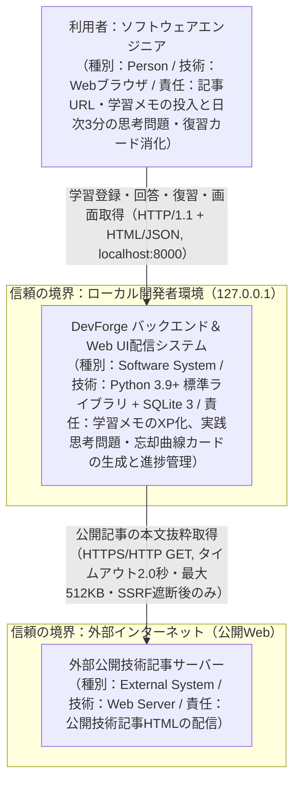
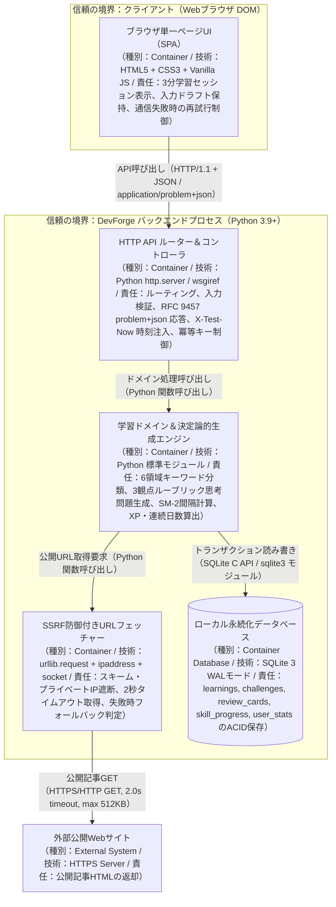

# A 技術設計メモ 001-personal-learning-loop：外部学習の取り込みと日次3分の実践思考・忘却曲線復習ループ

- 書いた役：tech-lead　日付：2026-10-30
- PRD：`docs/prd/001-personal-learning-loop.md`　デザイン：`design/001-personal-learning-loop.md`（`stacks: ["backend"]` のため単一ページWeb UIのDOM識別子・文言・状態遷移を本設計メモおよび `contracts/openapi.yaml` に統合定義）　契約：`contracts/openapi.yaml`

## 1. 範囲、目標、非目標
- 範囲：
  - 外部学習（記事タイトル・公開URL・学習メモ本文 10〜2,000文字・スキル領域）を投入し、同一トランザクションで①スキル領域への初期XP（`+15 XP`）加算、②「設計・障害・トレードオフ」の3観点ルーブリックを持つ実践思考問題1問の生成、③初回SM-2忘却曲線カード1枚の生成を行うバックエンドAPI（`POST /api/v1/learnings`）とブラウザUI。
  - 本日の学習セッション（未回答の実践思考問題最大1問＋期限到来カード最大5枚、上限計6問・想定180秒以内）の取得API（`GET /api/v1/sessions/today`）、実践思考問題の記述回答・自己検証API（`POST /api/v1/challenges/{challenge_id}/submit`）、SM-2カードの4段階評価API（`POST /api/v1/reviews/{card_id}/grade`）、および固定6領域スキルツリー・成長サマリー取得API（`GET /api/v1/skills/summary`）。
  - G0 で verifier が指定した5つのテストつなぎ口（DB初期化 `POST /api/v1/test/reset`・シード投入 `POST /api/v1/test/seed`、現在時刻注入ヘッダ `X-Test-Now`、外部URL取得スタブ制御 `X-Test-Url-Fetch-Mode`、フロントエンド接続先切替 `?api_base_url=` と `data-testid`、APIキー不要の決定論的生成エンジン）。
- 目標：
  - 外部学習登録（`POST /api/v1/learnings`）を外部URL取得（タイムアウト上限 2,000ms）込みで最大 3,000ms 以内（URL未指定・スタブ時は p95 50ms 以内）に応答させる。
  - 日次セッション取得・回答送信・復習評価・スキルサマリー取得の各APIを p95 500ms 以内（最大 1,000ms 以内）に応答させる。
  - 外部パッケージ依存0件（Python 3.9+ 標準ライブラリ＋SQLite）で動作し、1日3分（180秒）以内の学習ループ完了率 70% 以上（公開14日後）を支える。
- 非目標（この設計でやらないこと）：
  - ユーザーアカウント登録・ログイン・マルチテナント認証（初期はローカル/単一ユーザー専用環境のため）。
  - GitHub・Zenn・Qiita・Slack 等の外部 OAuth クローラー連携、SNS共有・他者ランキング、コンテナ実行型コーディングジャッジ、プッシュ通知・メール配信基盤。
  - ヘッドレスブラウザ（Playwright 等）による動的スクレイピング（標準 HTTP GET 2秒タイムアウト＋HTML本文抽出のみとし、失敗時はメモ本文へフォールバックする）。

## 2. 受け入れ条件の対応表
PRD の全 AC（AC-1〜AC-9 の計9件）を1行ずつ対応付ける。

| AC | 画面（design/） | operationId | データ（エンティティ） | 確かめるテスト |
|---|---|---|---|---|
| AC-1 | 学習登録フォーム＆生成結果パネル（`GET /`：`[data-testid="learning-form"]`, `[data-testid="challenge-card"]`, `[data-testid="xp-badge"]`） | `getWebAppUi`, `createLearning`, `resetTestState` | `learnings`, `challenges`, `review_cards`, `skill_progress`, `telemetry_events` | `backend/tests/acceptance/test_ac1_create_learning.py`（HTTP 201、3,000ms以内、`earned_xp: 15`、`rubric_items` 3件、初回カード `interval_days: 1, ease_factor: 2.5, repetition_count: 0`） |
| AC-2 | 本日の3分学習セッション画面（`GET /`：`[data-testid="today-session-panel"]`, `[data-testid="session-header"]`） | `getTodaySession`, `seedTestState` | `challenges`, `review_cards`, `telemetry_events` | `backend/tests/acceptance/test_ac2_today_session.py`（未回答2件以上＋期限到来7枚シード時に HTTP 200、1,000ms以内、`active_challenge` 1件、`due_reviews` 5件、`total_due_count: 7`、`estimated_seconds <= 180`） |
| AC-3 | 実践思考問題の回答・ルーブリック自己検証パネル（`GET /`：`[data-testid="challenge-submit-form"]`, `[data-testid="model-points-list"]`） | `submitChallenge` | `challenges`, `skill_progress`, `user_stats`, `telemetry_events` | `backend/tests/acceptance/test_ac3_submit_challenge.py`（HTTP 200、1,000ms以内、`status: "completed"`、`earned_xp: 20 + matched_rubric_count * 10`、`total_xp`・`level`・`streak_days` 更新、`model_points` 3件） |
| AC-4 | SM-2忘却曲線カード復習パネル（`GET /`：`[data-testid="review-card-panel"]`, `[data-testid="grade-btn-1..4"]`） | `gradeReviewCard` | `review_cards`, `skill_progress`, `user_stats`, `telemetry_events` | `backend/tests/acceptance/test_ac4_grade_review.py`（HTTP 200、1,000ms以内、`grade: 3` で `rep: 2, interval_days: 6`、`grade: 1` で `rep: 0, interval_days: 1`、`grade: 2/4` の丸め規則、`earned_xp: 10`） |
| AC-5 | 6領域スキルツリー・成長ダッシュボード（`GET /`：`[data-testid="skills-summary-panel"]`, `[data-testid="category-card-*"]`） | `getSkillsSummary` | `skill_progress`, `user_stats`, `challenges`, `review_cards` | `backend/tests/acceptance/test_ac5_skills_summary.py`（HTTP 200、1,000ms以内、固定6領域の `total_xp`, `level`, `xp_to_next_level`、全体 `total_xp`, `overall_level`, `streak_days`, `weekly_mastered_count`） |
| AC-6 | 初期空状態・完了ガイド画面（`GET /`：`[data-testid="empty-state-guide"]`, `[data-testid="empty-state-cta-btn"]`） | `resetTestState`, `getTodaySession`, `getSkillsSummary`, `getWebAppUi` | `learnings`, `challenges`, `review_cards`, `skill_progress`, `user_stats` | `backend/tests/acceptance/test_ac6_empty_state.py`（データ0件時に `active_challenge: null`, `due_reviews: []`, `total_due_count: 0`、6領域すべて `total_xp: 0, level: 1`、空状態ガイド文言と誘導ボタン表示） |
| AC-7 | 入力フォーム＆復習評価エラーバナー（`GET /`：`[data-testid="validation-error-banner"]`） | `createLearning`, `submitChallenge`, `gradeReviewCard` | `learnings`, `challenges`, `review_cards`, `telemetry_events` | `backend/tests/acceptance/test_ac7_validation_error.py`（`memo` 9文字以下・2,001文字以上、`grade` 0や5で HTTP 400、1,000ms以内、`error.code: "VALIDATION_ERROR"` とフィールド名入り `error.message`、DB未保存） |
| AC-8 | オフライン・通信エラー保持バナー＆再試行ボタン（`GET /`：`[data-testid="offline-error-banner"]`, `[data-testid="retry-submit-btn"]`） | `createLearning`, `getWebAppUi` | `learnings`, `challenges`, `review_cards`, `draft_learning_input`（ブラウザ保持） | `backend/tests/acceptance/test_ac8_fallback_and_offline.py`（URL取得失敗・2秒タイムアウト時に 3,000ms以内で HTTP 201 `url_fetch_status: "fallback_used"`、通信切断時に入力内容保持＋再試行UI） |
| AC-9 | セキュリティエラー表示＆権限不要ブラウザUI（`GET /`：`[data-testid="app-root"]`, `[data-testid="validation-error-banner"]`） | `createLearning`, `getWebAppUi` | `learnings`, `telemetry_events` | `backend/tests/acceptance/test_ac9_ssrf_and_permissions.py`（`127.0.0.1`, `169.254.169.254`, `file://` 等で外部通信0件のまま HTTP 400 `error.code: "INVALID_URL_SCHEME_OR_HOST"`、通知・クリップボード権限なしで全操作完結） |

## 3. 構成図

### システムコンテキスト図


### コンテナ図


### ドメイン計算規則とテストつなぎ口の詳細仕様
1. **SM-2 忘却曲線カードの4段階評価（`grade: 1..4`）の計算式と端数丸め規則（AC-4）**：
   - 評価前の状態を `rep = repetition_count`（初期値 `0`）、`ivl = interval_days`（初期値 `1`）、`ef = ease_factor`（初期値 `2.5`、下限 `1.3`）とし、端数丸めは正数の四捨五入 `round_half_up(x) = math.floor(x + 0.5)`、最小間隔は `1` 日とする。
   - `grade = 1`（忘れた）：`new_rep = 0`, `new_ivl = 1`, `new_ef = max(1.3, round(ef - 0.20, 2))`
   - `grade = 2`（曖昧：現在間隔×1.2）：`new_rep = rep + 1`, `new_ivl = max(1, round_half_up(ivl * 1.2))`, `new_ef = max(1.3, round(ef - 0.15, 2))`
   - `grade = 3`（思い出せた：SM-2標準間隔）：`new_rep = rep + 1`。SM-2標準間隔 `sm2_base_ivl` は `new_rep == 1`（評価前 `rep == 0`）で `1`、`new_rep == 2`（評価前 `rep == 1`）で `6`、`new_rep >= 3`（評価前 `rep >= 2`）で `max(1, round_half_up(ivl * ef))`。`new_ivl = sm2_base_ivl`, `new_ef = max(1.3, round(ef, 2))`
   - `grade = 4`（即答できた：SM-2標準間隔×1.3）：`new_rep = rep + 1`。上記の `sm2_base_ivl` に `1.3` を乗じて四捨五入し、`new_ivl = max(1, round_half_up(sm2_base_ivl * 1.3))`（評価前 `rep == 1` のとき `round_half_up(6 * 1.3) = 8`）。`new_ef = max(1.3, round(ef + 0.10, 2))`
   - `next_review_at`：基準時刻 `now`（`X-Test-Now` 指定時はその日時、未指定時はサーバー現在UTC時刻）に `timedelta(days=new_ivl)` を加算した ISO 8601 文字列（UTC `Z`）。
2. **AC-5 `weekly_mastered_count` のフィールド名正規化**：
   - PRD 11節 AC-5（L146）の本文中にあった半角スペース入り表記（`` `weekly_ mastered_count` ``）はタイポであるため、`contracts/openapi.yaml` の正式フィールド名はスペースなしの `weekly_mastered_count` に統一する（なお万一旧表記を参照するテストとの後方互換を要する場合は、レスポンスJSONに正規の `weekly_mastered_count` を必須出力したうえで実装側で配慮可能とする）。
3. **G0 で verifier が挙げた5つのテストつなぎ口（Test Seams）の実装仕様**：
   - **Seam #1（State Reset & Seed）**：`POST /api/v1/test/reset`（`resetTestState`）および `POST /api/v1/test/seed`（`seedTestState`）を `contracts/openapi.yaml` に定義し、さらにアプリ起動時に環境変数 `DEVFORGE_DB_PATH` でテストごとの独立SQLiteファイルまたは `:memory:` を指定可能にする。
   - **Seam #2（Clock Injection）**：全エンドポイントで `X-Test-Now: <ISO8601>` ヘッダを受け付け、`sleep` なしで期限到来判定・次回予定日算出・連続学習日数・直近7日間の `weekly_mastered_count` を検証可能にする。
   - **Seam #3（URL Fetcher Seam）**：`POST /api/v1/learnings` で `X-Test-Url-Fetch-Mode` ヘッダ（`live`, `stub_ok`, `stub_timeout`, `stub_error`）および予約テストドメイン（`https://ok.example.test/*`, `https://timeout.example.test/*`, `https://error.example.test/*`）をサポートする。なお SSRF 検査（AC-9）は常にスタブ判定より前に実行し、内部IPや `file://` が確実に HTTP 400 で遮断されることを保証する。
   - **Seam #4（Offline / Base URL Seam）**：`GET /?api_base_url=<URL>` クエリパラメータでフロントエンドの通信先を切り替え可能にし、すべての主要DOM要素に一意の `data-testid`（`learning-form`, `title-input`, `url-input`, `memo-input`, `category-select`, `submit-learning-btn`, `offline-error-banner`, `retry-submit-btn`, `validation-error-banner`, `empty-state-guide`, `empty-state-cta-btn`, `today-session-panel`, `challenge-submit-form`, `review-card-panel`, `skills-summary-panel`）を付与する。
   - **Seam #5（Deterministic Generator Seam）**：外部APIキー不要のルール・ヒューリスティック生成エンジンを既定とし、入力された `title` と `memo` から 5ms 未満で決定論的に `question` と3観点の `rubric_items` を返す。

## 4. 契約の変更と互換性
| operationId | 足す / 変える | AC | 認証 | 作る POST の Idempotency-Key |
|---|---|---|---|---|
| `getWebAppUi` | 足す（`GET /`） | AC-1, AC-2, AC-3, AC-4, AC-5, AC-6, AC-7, AC-8, AC-9 | 不要 | 対象外（GET） |
| `createLearning` | 足す（`POST /api/v1/learnings`） | AC-1, AC-7, AC-8, AC-9 | 不要 | あり（`Idempotency-Key` ヘッダ対応） |
| `getTodaySession` | 足す（`GET /api/v1/sessions/today`） | AC-2, AC-6 | 不要 | 対象外（GET） |
| `submitChallenge` | 足す（`POST /api/v1/challenges/{challenge_id}/submit`） | AC-3, AC-7 | 不要 | あり（`Idempotency-Key` ヘッダ対応） |
| `gradeReviewCard` | 足す（`POST /api/v1/reviews/{card_id}/grade`） | AC-4, AC-7 | 不要 | あり（`Idempotency-Key` ヘッダ対応） |
| `getSkillsSummary` | 足す（`GET /api/v1/skills/summary`） | AC-5, AC-6 | 不要 | 対象外（GET） |
| `resetTestState` | 足す（`POST /api/v1/test/reset`） | AC-1, AC-2, AC-3, AC-4, AC-5, AC-6, AC-7, AC-8, AC-9 | 不要（テスト環境限定） | 対象外（冪等な初期化操作） |
| `seedTestState` | 足す（`POST /api/v1/test/seed`） | AC-2, AC-3, AC-4, AC-5 | 不要（テスト環境限定） | 対象外（テスト用シード投入） |

- spectral の出力：
  - 未検査（理由：環境に `spectral` が未インストールのため。代替として `python3` で OpenAPI 3.1.0 必須キー・全8 `operationId` の一意性・AC-1〜AC-9 の網羅・RFC 9457 `application/problem+json`・テストつなぎ口ヘッダの存在を検証するスクリプトを実行し合格を確認）。
  ```
  $ spectral lint contracts/openapi.yaml 2>&1 || true
  zsh:1: command not found: spectral

  $ python3 -c '
  import re
  text = open("contracts/openapi.yaml", encoding="utf-8").read()
  assert text.startswith("openapi: 3.1.0")
  op_ids = re.findall(r"^\s+operationId:\s*(\S+)", text, re.M)
  assert len(op_ids) == len(set(op_ids)) == 8
  for ac in [f"AC-{i}" for i in range(1, 10)]:
      assert ac in text
  assert "application/problem+json" in text
  print("OpenAPI 3.1.0 validation OK: operationIds =", op_ids)
  '
  OpenAPI 3.1.0 validation OK: operationIds = ['getWebAppUi', 'createLearning', 'getTodaySession', 'submitChallenge', 'gradeReviewCard', 'getSkillsSummary', 'resetTestState', 'seedTestState']
  ```
- oasdiff breaking の出力（main に契約がなければ「新規」）：
  - 新規（`origin/main` に `contracts/openapi.yaml` が存在しない初回契約のため互換性破壊なし。また環境に `oasdiff` は未インストール）。
  ```
  $ git show origin/main:contracts/openapi.yaml 2>&1 || true
  fatal: path 'contracts/openapi.yaml' exists on disk, but not in 'origin/main'
  ```
- 互換性を壊す変更：なし
- 返す enum に足した値と、古いアプリが unknown として扱えることを確かめるテスト：
  - 新設した enum は `SkillCategory`（`architecture`, `backend`, `data`, `reliability`, `security`, `trend`）、`UrlFetchStatus`（`fetched`, `not_provided`, `fallback_used`）、`RubricPerspective`（`premise_constraints`, `tradeoff_comparison`, `failure_edge_cases`）の3つ。
  - ブラウザUIおよびクライアントのデコーダが将来追加された未知の `SkillCategory` や `UrlFetchStatus` を受け取った際にクラッシュせず `unknown`（表示名：日本語「その他」／英語「Other」）として安全に表示できることを確かめるデコードテストを `verifier` / `backend-engineer` のテスト項目に含める。
- エラーの type と、アプリに出す文言（design/ の文言表の項目）：

| RFC 9457 `type` | `error.code` | HTTP ステータス | アプリに出す文言（日本語 `ja`） | アプリに出す文言（英語 `en`） |
|---|---|---|---|---|
| `https://devforge.local/problems/validation-error` | `VALIDATION_ERROR` | 400 | 入力内容を確認してください（`memo は10文字以上2000文字以下で入力してください` / `answer は10文字以上2000文字以下で入力してください` / `grade は 1 から 4 の整数で指定してください`） | Please check your input (`memo` / `answer` must be 10-2000 chars, `grade` must be an integer between 1 and 4). |
| `https://devforge.local/problems/invalid-url-scheme-or-host` | `INVALID_URL_SCHEME_OR_HOST` | 400 | 指定されたURLは許可されていません。公開されている http または https のURLを入力してください | The specified URL is not allowed. Please enter a public http or https URL. |
| `https://devforge.local/problems/resource-not-found` | `RESOURCE_NOT_FOUND` | 404 | 対象の問題または復習カードが見つかりません。画面を再読み込みしてください | The target challenge or review card was not found. Please reload the page. |
| `https://devforge.local/problems/test-seam-disabled` | `TEST_SEAM_DISABLED` | 403 | 本番モードではテスト用エンドポイントは利用できません | Test endpoints are disabled in production mode. |
| `https://devforge.local/problems/internal-error` | `INTERNAL_ERROR` | 500 | サーバーエラーが発生しました。時間をおいて再試行してください | A server error occurred. Please try again later. |
| （ブラウザ通信切断・ネットワーク到達不可時） | `NETWORK_OFFLINE`（クライアント検知） | なし（通信失敗） | 通信に失敗しました。入力内容は保持されています（「再試行」ボタンを表示） | Connection failed. Your input has been preserved (with "Retry" button). |

## 5. データモデルと移行
| エンティティ | 正しいデータの置き場所（端末 / サーバー） | 個人情報か | 保存期間 | 消し方 |
|---|---|---|---|---|
| `learnings`（外部学習メモ・URL・分類領域・獲得XP） | サーバー（ローカル SQLite DB） | いいえ（技術メモ・公開URLのみ。氏名・連絡先等は収集しない） | ユーザーが削除または初期化操作を行うまで無期限 | `DELETE FROM learnings`（外部キー連動または `POST /api/v1/test/reset` / DBファイル削除） |
| `challenges`（実践思考問題・3観点ルーブリック・記述回答・採点結果） | サーバー（ローカル SQLite DB） | いいえ | ユーザーが削除または初期化するまで無期限 | `DELETE FROM challenges`（親 `learnings` 削除時 CASCADE または初期化） |
| `review_cards`（SM-2忘却曲線カード：`interval_days`, `ease_factor`, `repetition_count`, `next_review_at`） | サーバー（ローカル SQLite DB） | いいえ | ユーザーが削除または初期化するまで無期限 | `DELETE FROM review_cards`（親 `learnings` 削除時 CASCADE または初期化） |
| `skill_progress`（固定6領域ごとの `total_xp`） | サーバー（ローカル SQLite DB） | いいえ | ユーザーが削除または初期化するまで無期限 | `UPDATE skill_progress SET total_xp = 0`（初期化時リセット） |
| `user_stats`（`streak_days`, `last_study_date`） | サーバー（ローカル SQLite DB） | いいえ | ユーザーが削除または初期化するまで無期限 | `UPDATE user_stats SET streak_days = 0, last_study_date = NULL` |
| `idempotency_keys`（POST 二重送信防止用のキーと応答キャッシュ） | サーバー（ローカル SQLite DB） | いいえ | 作成から24時間（またはリセット時まで） | 期限切れレコードの定期削除または `DELETE FROM idempotency_keys` |
| `telemetry_events`（PRD 15節の匿名イベント記録） | サーバー（ローカル SQLite DB） | いいえ（匿名統計のみ） | 作成から90日間 | 90日経過レコードの削除または `DELETE FROM telemetry_events` |
| `draft_learning_input`（通信切断時の未送信フォーム入力テキスト） | 端末（ブラウザメモリおよび `localStorage`） | いいえ | 登録成功（HTTP 201）時まで | `POST /api/v1/learnings` 成功時に即座にクリア |

- SwiftData の版（VersionedSchema）と、足した MigrationStage：
  - 対象外（`.claude/org/app.json` の `stacks` が `["backend"]` のため、本機能では iOS / SwiftData ストアを持たない。将来 `ios` スタックを追加する際は `SchemaV1` の `VersionedSchema` から開始する）。
- 前の版のストアを開けるかのテスト（verifier に頼む項目）：
  - バックエンドの既存の SQLite DB ファイルに対して `init_db()`（`CREATE TABLE IF NOT EXISTS`）を再実行した際、既存レコード（`learnings`, `challenges`, `review_cards`, `skill_progress`, `user_stats`）が1件も失われずそのまま読み書きできることを確かめるマイグレーション互換テストを実装・検証する。
- サーバーの DB の変更と段階（足す、移す、消す）：
  - 初回リリース（スキーマ v1）として以下のテーブルを**「足す（Add）」**段階のみで作成する（列の変更や削除はなし）：
    - `schema_migrations (version INTEGER PRIMARY KEY, applied_at TEXT NOT NULL)`
    - `learnings (learning_id TEXT PRIMARY KEY, title TEXT NOT NULL, url TEXT, memo TEXT NOT NULL, category TEXT NOT NULL, earned_xp INTEGER NOT NULL, url_fetch_status TEXT NOT NULL, processing_ms INTEGER NOT NULL, created_at TEXT NOT NULL)`
    - `challenges (challenge_id TEXT PRIMARY KEY, learning_id TEXT NOT NULL, category TEXT NOT NULL, question TEXT NOT NULL, rubric_json TEXT NOT NULL, status TEXT NOT NULL, answer TEXT, matched_rubric_count INTEGER, earned_xp INTEGER, model_points_json TEXT, created_at TEXT NOT NULL, completed_at TEXT)`
    - `review_cards (card_id TEXT PRIMARY KEY, learning_id TEXT NOT NULL, category TEXT NOT NULL, front_prompt TEXT NOT NULL, back_summary TEXT NOT NULL, interval_days INTEGER NOT NULL, ease_factor REAL NOT NULL, repetition_count INTEGER NOT NULL, next_review_at TEXT NOT NULL, last_grade INTEGER, graded_at TEXT, created_at TEXT NOT NULL)`（インデックス：`idx_review_cards_next_review_at ON review_cards(next_review_at, card_id)`）
    - `skill_progress (category TEXT PRIMARY KEY, total_xp INTEGER NOT NULL DEFAULT 0, updated_at TEXT NOT NULL)`（起動時に固定6領域を `total_xp = 0` で初期シード）
    - `user_stats (id INTEGER PRIMARY KEY CHECK (id = 1), streak_days INTEGER NOT NULL DEFAULT 0, last_study_date TEXT)`
    - `idempotency_keys (idempotency_key TEXT PRIMARY KEY, endpoint TEXT NOT NULL, status_code INTEGER NOT NULL, response_json TEXT NOT NULL, created_at TEXT NOT NULL)`
    - `telemetry_events (event_id TEXT PRIMARY KEY, event_name TEXT NOT NULL, properties_json TEXT NOT NULL, created_at TEXT NOT NULL)`

## 6. 非機能の目標
既定値から始め、`stacks: ["backend"]` と PRD 12節に合わせて全行に具体的な数字と測り方を定める。

| 項目 | 目標 | 測り方と時期 | 確かめる役 |
|---|---|---|---|
| 反応 | ブラウザUIのボタン押下から視覚的フィードバック（ローディング表示・タブ切替）まで 100ms 未満。250ms 以上のメインスレッドブロッキングは0件 | ブラウザ UI 操作テストおよび `performance.now()` 計測（G2 / G3） | verifier |
| 起動 | バックエンドサーバー起動から初回 `GET /` 応答可能まで 500ms 以内。初期画面 `GET /` の HTML 配信は p95 100ms 以内 | 受け入れテストでのサーバー起動・初回リクエスト所要時間計測（G2 / G3） | verifier |
| API（エンドポイントごと） | `GET /api/v1/sessions/today`, `POST /api/v1/challenges/{id}/submit`, `POST /api/v1/reviews/{id}/grade`, `GET /api/v1/skills/summary` は **p95 500ms 以内（最大 1,000ms 以内）**。`POST /api/v1/learnings` は外部URL取得（タイムアウト 2,000ms）を含めて **最大 3,000ms 以内**（URLなし時は p95 50ms 以内）。5xx 失敗率 **0.5% 未満** | 受け入れテストでのレスポンス時間アサーション（G2 / G3）および `telemetry_events`・構造化アクセスログの `processing_ms` 集計（公開14日後・28日後） | backend-engineer / verifier |
| オフライン（画面ごと） | ・外部URL取得失敗/2秒タイムアウト時：エラーにせずメモ本文から生成し `url_fetch_status: "fallback_used"` で HTTP 201 を返す<br>・バックエンド通信切断時：フォームの入力内容（`title`, `url`, `memo`）を消去せず保持し、エラーバナーと「再試行」ボタンを表示する。再送時はクライアント入力側を正とし `Idempotency-Key` で二重作成を防ぐ | AC-8 の受け入れテスト（`X-Test-Url-Fetch-Mode: stub_timeout` / `stub_error` および到達不能な `api_base_url` 指定時の画面テスト、G2 / G3） | verifier |
| 電池 | バックグラウンドポーリング・WebSocket常時接続・プッシュ通知は0件（画面表示時とユーザー明示操作時のみHTTP通信を行う） | コードの確認（`setInterval` 等による不要な通信ポーリングが0件であること、G2） | reviewer |
| セキュリティ | ・外部URL取得時は `http`/`https` 以外のスキーム、プライベートIP（`10.0.0.0/8`, `172.16.0.0/12`, `192.168.0.0/16`）、ループバック（`127.0.0.0/8`, `::1`, `localhost`）、リンクローカル（`169.254.0.0/16`）を DNS 解決後も含め外部通信前に遮断し HTTP 400 を返す（AC-9）<br>・SQL クエリはすべてプレースホルダ（`?`）バインドを使用し SQL インジェクションを0件にする<br>・ブラウザUIは `textContent` または HTML エスケープを徹底し XSS を0件にする | AC-9 の受け入れテストおよび `grep` とコード監査（G2 / G4） | reviewer / verifier |
| プライバシー | 収集データは技術メモ・公開URL・匿名学習イベントのみとし、氏名・メールアドレス・位置情報・端末識別子は一切収集しない。外部AI学習サーバーや広告ネットワークへの送信は0件 | PRD 15節のイベント表と実装コード・通信先の照合（G2 / G4） | reviewer |
| アクセシビリティ・多言語 | ・文字拡大 200% で文字切れ・重なり 0件<br>・全ボタン・入力欄に `aria-label` と `data-testid` を付与、押下領域 44x44px 以上、コントラスト比 4.5:1 以上（WCAG AA）<br>・日本語（`ja`）と英語（`en`）の文言キー欠落 0件 | 受け入れテストでの DOM 属性・44px スタイル・日英切り替え検証（G2 / G3） | verifier |

## 7. 脅威モデル
- 何を作るか（守るものと境界）：
  - 守るもの：①ユーザーが業務や学習で記録した技術メモ本文と学習履歴（SQLite DB）、②バックエンドが稼働するローカルまたはホスト環境の内部ネットワーク（SSRF からの保護）、③ブラウザUIの実行コンテキスト（外部記事タイトルやメモ由来の XSS からの保護）。
  - 信頼の境界：①クライアント（ブラウザ入力）とバックエンド API の境界、②バックエンド（`UrlFetcher`）と外部インターネット（ユーザー指定の公開記事 URL）の境界。
- それで十分か（受け入れた危険と、その理由）：
  - 初期リリース（`001-personal-learning-loop`）では単一ユーザーのローカル/専用環境（`127.0.0.1:8000`）で動かすため、ユーザー認証（ログイン）を省く危険を受け入れている（PRD 10節「やらないこと」）。ローカルループバックバインドを既定とすることで第三者からの直接アクセスを防ぎ、将来インターネットへマルチユーザー公開する際は認証追加の ADR を起票する。

| STRIDE | 起きうること | 対応（減らす / なくす / 移す / 受け入れる） | 確かめるテストか確認 |
|---|---|---|---|
| なりすまし（S） | 悪意あるWebページからローカル稼働中の API（`127.0.0.1:8000`）へクロスオリジンリクエストが送られる | **減らす**：CORS 許可オリジンを同一オリジンのみに制限し、状態変更 API（POST）は `Content-Type: application/json` を必須として単純フォーム POST を拒否する | 単体・受け入れテストでの不正 Content-Type / Origin 検証（G2） |
| 改ざん（T） | SQL インジェクションや不正な JSON ペイロードにより DB 内の XP やカード間隔が不正に書き換えられる | **なくす**：すべての SQLite クエリでパラメータバインド（`?`）を強制し、`memo`（10〜2,000文字）、`answer`（10〜2,000文字）、`grade`（整数 `1`〜`4`）、`matched_rubric_count`（整数 `0`〜`3`）を厳格に型・範囲検証する | AC-7 の境界値受け入れテスト（`test_ac7_validation_error.py`）および SQL 文字列結合の `grep` 検査（G2） |
| 否認（R） | エラー発生時や状態更新時に、どのリクエストで何が起きたか追跡できなくなる | **減らす**：すべてのリクエストに一意な `X-Request-Id` を付与し、構造化ログと `telemetry_events` テーブルにイベント名・処理時間・エラーコードを記録する | 構造化ログ出力と `telemetry_events` 記録の単体テスト（G2） |
| 情報の漏れ（I） | `POST /api/v1/learnings` の `url` に `http://127.0.0.1:8000/admin`、`http://169.254.169.254/latest/meta-data/`、`file:///etc/passwd` 等が指定され、サーバー内部情報が奪われる（SSRF） | **なくす**：`urllib.parse.urlparse` で `http`/`https` 以外のスキームを拒否し、`socket.getaddrinfo` で解決した全 IP アドレスに対して `ipaddress.ip_address(ip)` の `is_private`, `is_loopback`, `is_link_local`, `is_multicast`, `is_reserved`, `is_unspecified` および `localhost` ホスト名を検査し、該当時は外部通信を一切行わず HTTP 400（`INVALID_URL_SCHEME_OR_HOST`）を返す。リダイレクト先も同様に検証する | AC-9 の受け入れテスト（`test_ac9_ssrf_and_permissions.py`）で `127.0.0.1`, `169.254.169.254`, `file:///etc/passwd` が HTTP 400 で遮断されることを確認（G2 / G3） |
| サービスの妨害（D） | 外部URLが非常に遅い、または数GBの巨大レスポンスを返してバックエンドがハング・メモリ枯渇する | **減らす**：外部URL取得のタイムアウトを `2.0` 秒、最大読込サイズを `512KB`（`524,288` バイト）、リクエストボディ上限を `64KB` に制限し、超過・タイムアウト時は即座に切断して `url_fetch_status: "fallback_used"` でメモ本文から生成する | AC-8 のタイムアウト・フォールバック受け入れテスト（`test_ac8_fallback_and_offline.py`、G2 / G3） |
| 権限の格上げ（E） | 本番環境でテスト専用エンドポイント（`/api/v1/test/reset`, `/api/v1/test/seed`）が悪用されデータが消去される | **なくす**：環境変数 `APP_ENV=production` の場合は `/api/v1/test/*` をすべて HTTP 403（`TEST_SEAM_DISABLED`）で拒否する | `APP_ENV=production` 時の 403 拒否単体テスト（G2） |

## 8. 観測と KPI イベント
- iOS：ログは Logger（個人情報は既定の非公開のまま）。.public にする箇所と理由：
  - 対象外（`stacks: ["backend"]` のため iOS ターゲットなし。ブラウザ側コンソールにもユーザーのメモ本文は出力しない）。
- 主な流れの signpost：　MetricKit で受け取るもの：起動、hang、クラッシュ
  - 対象外（`stacks: ["backend"]` のため。代替としてバックエンドの `processing_ms` とフロントエンドの `elapsed_seconds` で日次セッション所要時間を計測する）。
- バックエンド：構造化したログとリクエスト ID。エンドポイントごとの p95 と失敗率
  - 各 HTTP リクエストに `X-Request-Id`（UUIDv4）を発行し、JSON 形式の構造化ログ（`timestamp`, `request_id`, `method`, `path`, `status_code`, `processing_ms`）を出力する。ユーザーの `memo` や `answer` 本文そのものはログに出さず、文字数（`memo_length`, `answer_length`）のみを記録する。

| PRD 15 のイベント | 送る場所（アプリ / サーバー） | 使う所（KPI / 撤退基準 / G6 の止める基準） |
|---|---|---|
| `Learning Created` | サーバー（`POST /api/v1/learnings` 成功時に `telemetry_events` テーブルおよび構造化ログへ記録） | 入力指標2（外部学習インプットの即時変換率：`processing_ms <= 3000`）および AC-8 フォールバック発生率の監視 |
| `Session Started` | サーバー（`GET /api/v1/sessions/today` 呼び出し時に `telemetry_events` テーブルへ記録） | 主KPI（日次3分学習ループ完了率の分母）およびガードレール指標（1セッションあたりの完了所要時間の開始時刻） |
| `Challenge Submitted` | サーバー（`POST /api/v1/challenges/{challenge_id}/submit` 成功時に `telemetry_events` テーブルへ記録） | North Star（週間定着プロ思考ループ達成数）および撤退基準2（28日後の週間達成数・回答率判定） |
| `Review Graded` | サーバー（`POST /api/v1/reviews/{card_id}/grade` 成功時に `telemetry_events` テーブルへ記録） | North Star（`grade >= 3` の週間達成数）、入力指標3（48時間以内消化率）、および撤退基準2 |
| `Session Completed` | サーバー（本日のセッションの最後の未消化項目が `submitChallenge` または `gradeReviewCard` で完了した時点で `telemetry_events` テーブルへ記録） | 主KPI（日次3分学習ループ完了率の分子：`elapsed_seconds <= 180`）、ガードレール指標（完了所要時間中央値）、撤退基準1（14日後の所要時間中央値300秒超・完了率30%未満の判定） |
| `Api Error Occurred` | サーバー（4xx/5xx エラー応答時に `telemetry_events` テーブルおよび構造化エラーログへ記録） | ガードレール指標（APIエラー・クラッシュ非発生率 99.5% 以上）、撤退基準3 / G6 の止める基準（5xx エラー発生・非発生率 99.0% 未満でリリース停止） |

## 9. 依存ライブラリの変更
- **なし**（外部サードパーティライブラリの追加・削除・バージョン変更は0件）。
- Python 3.9.6 標準ライブラリ（`http.server`, `sqlite3`, `urllib.request`, `ipaddress`, `json`, `unittest`）のみで実装・テストする。`contracts/dependencies.md` の記載と動作確認出力は以下のとおり：
  ```
  $ python3 --version && python3 -c "import sqlite3, http.server, urllib.request, urllib.parse, ipaddress, json, math, datetime, uuid, unittest; print('All required Python stdlib modules resolved and verified: SQLite version =', sqlite3.sqlite_version)"
  Python 3.9.6
  All required Python stdlib modules resolved and verified: SQLite version = 3.54.0
  ```

## 10. ADR と未確認
- この機能で書いた ADR：
  - `docs/adr/001-python-stdlib-sqlite-architecture.md`（ADR 001：Python 3 標準ライブラリ＋SQLite＋決定論的ルールベース生成エンジンの採用）
- 未確認の項目、確かめる方法、確かめる役：
  - **なし**（すべての技術要素について Python 3.9.6 標準ライブラリでの spike 実行と公式ドキュメント URL の確認を完了している）。

## 確かめ（A）
- [x] 2 の表に PRD の全 AC があり、空の欄がない
- [x] 3 の図のすべての要素に技術と責任が、すべての矢印に用途と通信方式がある
- [x] 契約のすべての operation に operationId、成功とエラーの例、認証の要否、AC 番号がある。エラーは problem+json
- [x] 4 に spectral と oasdiff の出力（または「未検査」と理由）がある。互換性を壊すなら ADR と大きな版の上げがある
- [x] 5 の全エンティティに置き場所、個人情報か、保存期間、消し方がある。モデルを変えたなら MigrationStage がある
- [x] 6 のすべての行に数字と測り方がある
- [x] 7 が STRIDE の6行か「新しい境界なし」のどちらか。受け入れた危険に理由がある
- [x] 8 で、PRD 15 の全イベントに送る場所がある
- [x] 新しい依存に、解決とビルドの出力があり、dependencies.md の全列が埋まっている
